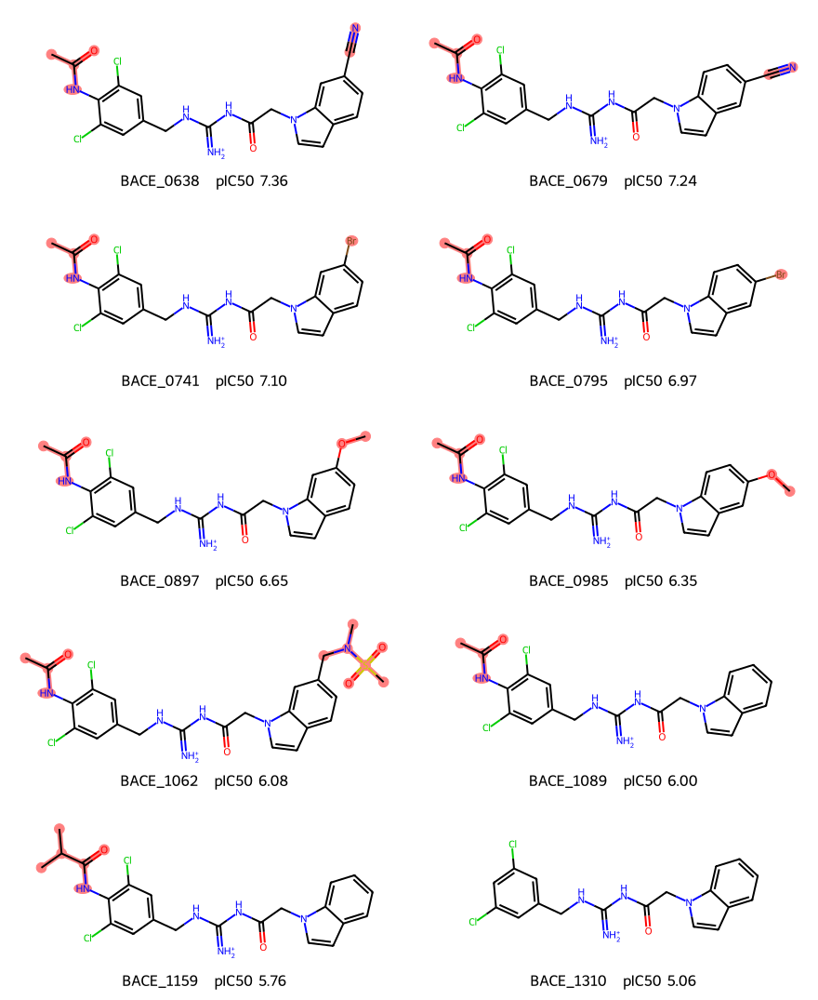

# 附录 · BACE_0638 的预测误差

0638 和 0070 的实测 IC50 都是 44 nM。只用明确 IC50 训练后，种子 0 的 Qwen 给它们的预测分别为 5.25 和 7.30 pIC50。下面从 0638 同骨架的十个分子查起，再用全测试集、训练近邻和保存的回归头逐步核对。文中涉及的向量替换都发生在同一个已训练的回归头上。三个模型在整个测试集上的成绩见[主报告](RESULTS.md#训练和验证也只用明确-ic50qwen-还能赢三次吗)。

## BACE_0638 这组的十个分子

种子 0 的组内反超主要落在 **0638、0679、0741、0795** 上。沿用上一节的计分方式：逐条算 Qwen 平方误差减 MoLFormer 平方误差，再在组内求和。从混合训练换到明确 IC50 训练，这个差从 −5.84 变为 +10.52。四条贡献了 +16.08，占全组净变化 +16.36 的 98.3%。其余六条合计 +0.28，个别影响方向相反，相加后大多抵消。

下表的实测和预测均为 pIC50。每格先列 Qwen，再列 MoLFormer。最后一列按未取整的预测计算，正数表示改用明确 IC50 训练后，差距向 MoLFormer 移动。三个种子在两种训练方式下的全部预测另附在表后。

| BACE 编号 | 实测 | 混合训练，种子 0 | 明确 IC50，种子 0 | 明确 IC50，种子 1 | 明确 IC50，种子 2 | 种子 0 差值变化 |
|---|---:|---:|---:|---:|---:|---:|
| 0638 | 7.36 | 5.97 / 4.94 | 5.25 / 5.49 | 5.98 / 5.34 | 5.82 / 5.30 | +4.85 |
| 0679 | 7.24 | 6.13 / 5.03 | 5.26 / 5.41 | 6.01 / 5.26 | 5.95 / 5.37 | +4.23 |
| 0741 | 7.10 | 5.60 / 5.96 | 4.94 / 6.84 | 5.84 / 6.00 | 5.81 / 6.44 | +3.65 |
| 0795 | 6.97 | 5.81 / 5.96 | 5.05 / 6.75 | 5.87 / 5.95 | 5.92 / 6.33 | +3.35 |
| 0897 | 6.65 | 5.61 / 6.39 | 5.49 / 5.73 | 5.05 / 6.23 | 5.00 / 5.17 | −0.52 |
| 0985 | 6.35 | 5.37 / 6.21 | 5.34 / 5.46 | 5.13 / 6.17 | 5.40 / 5.25 | −0.71 |
| 1062 | 6.08 | 6.72 / 6.79 | 6.06 / 7.14 | 6.83 / 6.55 | 6.33 / 6.78 | −1.04 |
| 1089 | 6.00 | 5.41 / 6.43 | 4.45 / 6.36 | 5.25 / 5.35 | 5.34 / 6.09 | +2.09 |
| 1159 | 5.76 | 5.50 / 6.38 | 4.89 / 6.32 | 5.69 / 5.36 | 5.46 / 5.81 | +0.77 |
| 1310 | 5.06 | 4.40 / 6.37 | 5.28 / 6.34 | 4.93 / 5.65 | 5.12 / 6.19 | −0.30 |

**真正从 Qwen 更准变为 MoLFormer 更准的是 0638、0679 和 1159。** 前两条在种子 0 都被两个模型低估：换训练数据后，Qwen 的预测更低，MoLFormer 的预测升高。0741、0795 原本就是 MoLFormer 更准。这两条占明确 IC50 训练后最终差距的最大两项（+4.62、+3.66），因为 MoLFormer 已接近实测值，Qwen 却把两条都估在 5 左右。1062 的变化方向相反，Qwen 的 6.06 接近实测 6.08，MoLFormer 却高估到 7.14。[三个种子的实测值、新旧预测和误差贡献](final/bace/ic50_only/scaffold_0638/predictions.csv)

**四条共享什么特征？** 十条都来自同一篇论文，原始记录都是有等号的 IC50，范围为 0.044–8.75 µM。结构也可以逐个对齐：十条都有二氯苄基、带正电的酰基胍和吲哚环。贡献最大的四条在二氯苯环上都带乙酰氨基；在吲哚环上，0638、0679 各带一个氰基，0741、0795 各带一个溴，各对仅取代位置不同。它们恰好是实测活性最高的四条，IC50 依次为 44、57、79、106 nM。相同两个位置换成甲氧基的 0897、0985 实测为 224、450 nM，种子 0 的变化反而分别为 −0.52、−0.71。[结构、化合物编号和原始浓度](final/bace/ic50_only/scaffold_0638/structures.csv)



**种子 1、2 没有重复这次反超。** 同样四条在这两个种子下分别只带来 +0.60、+0.92 的净变化。明确 IC50 训练后，两条氰基分子都由 Qwen 更准，两条溴取代分子仍由 MoLFormer 更准。十条合计的平方误差差分别为 −0.23、−2.71，都是 Qwen 略低。高活性和这两种取代在这四条上重合，现有预测能定位到这几个样本，但不能分清是活性范围还是取代结构导致了种子 0 的误差。

## 0638 以外的高活性分子也被低估了吗？

是。用 992 条明确 IC50 训练记录的平均 pIC50（6.806）作分界，268 条测试记录有 83 条高于这个值。种子 0 的 Qwen 低估了其中 77 条，平均误差为 −1.059 pIC50；其余 185 条的平均误差为 +0.161。把 0638 整个骨架排除后，高活性记录还剩 79 条，Qwen 低估了 73 条；按骨架分别求平均误差，49 种里有 46 种偏低。把分界提高到训练集上四分位数（7.638），骨架外剩下的 27 条全部被低估。这里讨论的是明确 IC50 训练后的模型，所有误差均按“预测减实测”计算。[全部记录与各组的计数、偏差和 RMSE](final/bace/ic50_only/high_activity/summary.csv)

| 模型、种子 | 高活性 83 条：低估数／平均误差 | 排除 0638 骨架后 79 条：低估数／平均误差 | 氰基和溴取代 4 条：平均误差 | 异骨架匹配对照 12 条：平均误差 |
|---|---:|---:|---:|---:|
| Qwen 0 | 77／−1.059 | 73／−1.009 | −2.045 | −0.892 |
| Qwen 1 | 76／−0.835 | 72／−0.814 | −1.242 | −0.597 |
| Qwen 2 | 77／−0.870 | 73／−0.848 | −1.296 | −0.689 |
| MoLFormer 0 | 78／−0.866 | 74／−0.857 | −1.045 | −0.797 |
| MoLFormer 1 | 81／−1.069 | 77／−1.046 | −1.531 | −0.895 |
| MoLFormer 2 | 77／−0.857 | 73／−0.834 | −1.309 | −0.879 |

**相同活性，换个骨架会怎样？** 给四条各配三条测试对照，只按实测 pIC50 的距离挑选。排除了目标所在的整个结构相似组，12 个对照各用一种不同的 Murcko 骨架。目标与对照最大的活性差为 0.039 pIC50，六次模型比较共用同一份名单。

| 目标 | 测试对照（均省略 BACE_） | 种子 0 Qwen 对目标的误差 | 对三条对照的平均误差 |
|---|---|---:|---:|
| 0638（氰基） | 0070、0628、0648 | −2.106 | −0.709 |
| 0679（氰基） | 0080、0694、0078 | −1.981 | −0.851 |
| 0741（溴） | 0093、0738、0757 | −2.165 | −1.283 |
| 0795（溴） | 0101、0805、0784 | −1.926 | −0.727 |

0638 和 0070 实测都是 7.357。种子 0 的 Qwen 给前者 5.250，给后者 7.300；MoLFormer 分别给出 5.491、6.800。四条目标的低估幅度均大于各自三个对照的平均值。放宽到目标活性 ±0.10 内的所有组外记录，每条可找到 8–15 条，种子 0 的 Qwen 在四个目标上仍都低估得更多。种子 1、2 的 Qwen 也低估高活性分子，但四条目标与匹配对照的平均误差相差约 0.65、0.61，均小于种子 0 的 1.15。[每一对的实测值和两模型三次预测](final/bace/ic50_only/high_activity/matched_predictions.csv) · [放宽活性窗口后的对照](final/bace/ic50_only/high_activity/paired_bias.csv)

**四条对全体排名有多大影响？** 种子 0 在 83 条高活性记录上的平方误差总和，Qwen 比 MoLFormer 多 32.68；四条贡献 9.81（约 30%），其余 79 条贡献 22.87。在较低活性的 185 条上 Qwen 追回 4.12。合并全部 268 条，Qwen 仍多 28.56；即使去掉整个 0638 骨架，仍多 18.04。上节的 98.3% 指这四条占**该骨架从混合训练换到明确 IC50 训练时的净变化**，分母与这里不同。因而这组最突出的是低估幅度。这个单次划分里的高活性低估跨越许多骨架，两种模型都有；四条来自同一骨架，匹配也只控制了活性，无法由此确定氰基或溴对模型误差的独立作用。

## 同为 44 nM，0638 和 0070 为什么预测不同？

原始记录里，0638 是一篇论文的化合物 25，0070 是另一篇的化合物 6。两篇都报告 IC50 = 0.044 µM，换算为 pIC50 都是 7.357。数值相同，实验来源不同。两条的结构也差得远，Morgan 指纹相似度为 0.123。以下只从本轮用于训练的 992 条明确 IC50 中找近邻。[测量值、来源与模型输入 SMILES](final/bace/ic50_only/equal_activity_pair/measurements.csv)

0638 带有氰基吲哚和酰基胍，最接近的训练指纹也只有 0.221（1280）。1280 同样有腈基，但环系和中间连接部分都不同，实测 pIC50 为 5.21。0070 的最近邻 0313 则保留了带羟基和胺的链段、苄基和乙酰氨基，指纹相似度为 0.524，实测为 8.24。图中采用与模型一致的无手性连接结构。[两条测试分子与最近训练分子的结构图](final/bace/ic50_only/equal_activity_pair/structures.png)

| 近邻怎么找 | 0638 最近训练 ID（实测） | 0070 最近训练 ID（实测） | 前五条平均实测：0638／0070 |
|---|---|---|---:|
| Morgan 指纹 | 1280（5.21） | 0313（8.24） | 6.63／6.98 |
| Qwen 原始冻结向量 | 0049（7.72） | 0288（8.44） | 6.80／8.41 |
| Qwen 回归头输入，已标准化 | 0145（5.85） | 0313（8.24） | 6.23／8.41 |
| MoLFormer 原始冻结向量 | 0125（6.38） | 0313（8.24） | 6.08／8.27 |
| MoLFormer 回归头输入，已标准化 | 0190（3.68） | 0313（8.24） | 6.48／8.27 |

**0070 周围的高活性记录更集中。** Qwen 原始向量前十个近邻的实测值全都超过 0070，平均为 8.41。0638 的第一近邻 0049 其实也有 7.72，比目标还高；但前五条里只有它达到目标，均值为 6.80。用训练时保存的缩放器把每一维标准化后，0638 的最近邻换为 0145，前五均值降至 6.23。把邻居数放宽到十个，两个编码器在原始向量和标准化向量下仍都是 0070 一侧的平均活性更高。指纹按 Tanimoto 排序，向量按各自空间内的余弦排序。[各方法前十个训练 ID、相似度、标签与结构](final/bace/ic50_only/equal_activity_pair/neighbors.csv)

| 模型 | 种子 | 0638 预测 | 0070 预测 | 两条预测差（0070 减 0638） |
|---|---:|---:|---:|---:|
| Qwen | 0 | 5.250 | 7.300 | 2.049 |
| Qwen | 1 | 5.981 | 6.906 | 0.925 |
| Qwen | 2 | 5.817 | 7.388 | 1.571 |
| MoLFormer | 0 | 5.491 | 6.800 | 1.309 |
| MoLFormer | 1 | 5.341 | 6.717 | 1.376 |
| MoLFormer | 2 | 5.305 | 6.407 | 1.103 |

六个回归头都给 0070 更高的预测，也都在 0070 上更接近实测值；Qwen 种子 0 把两者拉得最开。我们把这个回归头重新用于它标准化空间里的前五个训练近邻，得到的平均输出分别为 6.50、7.95。对 0638 本身，它却只给 5.25，比这批近邻的平均输出还低 1.25。近邻活性与预测差的**方向**一致，但模型用的是训练好的 MLP，不能把差距当作近邻均值直接相减的结果。各个种子读取相同的冻结向量和缩放结果，Qwen 的预测差仍从 0.925 到 2.049 不等。种子 0 选中第 1 轮的回归头是已知事实，仅凭这对分子无法把额外的低估归因于早停或氰基。[各邻域的实测和回归头输出](final/bace/ic50_only/equal_activity_pair/neighborhoods.csv) · [六个检查点的预测](final/bace/ic50_only/equal_activity_pair/seed_predictions.csv)

## 0638 的五个近邻平均得 6.50，它为什么只有 5.25？

Qwen 种子 0 给 0638 的预测为 5.250，给五个训练近邻的预测依次为 5.804、6.781、6.292、7.487、6.149。五条都比 0638 高。即使去掉预测最高的 0340，另外四条平均仍比 0638 高 1.006 pIC50。这里解释的是五个预测的均值与 0638 预测之间的 **1.252**。0638 的实测值为 7.357，它相对实测值低了 2.106。[每个训练近邻的预测和差值](final/bace/ic50_only/hidden_gap/neighbors.csv)

回归头有 128 个 ReLU 隐藏单元，最后一层把它们的激活值加权求和。对每个单元，用“五个近邻的平均激活 − 0638 的激活”乘以输出权重（已换回 pIC50 单位），就能算出它对 1.252 的贡献。输出层偏置在相减时抵消。下表列出拉大差距最多的三项，以及抵消最多的一项。单元从 1 开始编号。

| 单元 | 0638 激活 | 五个近邻平均激活 | 输出权重 | 对差值的贡献 | 同一单元对 0070 与其近邻差值的贡献 |
|---:|---:|---:|---:|---:|---:|
| 56 | 0.000 | 2.155 | +0.0730 | +0.157 | −0.037 |
| 11 | 0.000 | 1.751 | +0.0811 | +0.142 | +0.009 |
| 64 | 2.629 | 0.892 | −0.0773 | +0.134 | +0.021 |
| 58 | 0.000 | 0.923 | −0.0822 | −0.076 | −0.001 |

56、11 号在五个近邻上都有激活，都给预测加分，在 0638 上则都为零。64 号的作用刚好反过来，它的权重为负，0638 在这个单元上比五个近邻中的每一个都更活跃，扣分也更多。这三项合计 **+0.434**，其余 125 项合计 **+0.818**。所有拉大差距的项加起来有 +2.078，反方向的项抵消了 0.826。换成同样测得 44 nM 的 0070，56、11、64 号合计只有 −0.007；这时拉大差距最多的是 87 号（+0.066）。[全部单元的激活、权重和带符号贡献](final/bace/ic50_only/hidden_gap/units.csv)

下表都用“近邻平均预测 − 目标预测”，单位为 pIC50。每个编码器在自己的标准化向量空间里，从 992 条明确 IC50 训练分子中取五个余弦最近邻。同一模型的三个种子共用同一份近邻名单。每个回归头独立训练，单元编号只在同一个头内对照。

| 模型 | 种子 | 0638 的差值 | 0070 的差值 | 对 0638 正向贡献最大的单元 |
|---|---:|---:|---:|---|
| Qwen | 0 | 1.252 | 0.653 | 56（+0.157） |
| Qwen | 1 | 0.458 | 0.894 | 61（+0.142） |
| Qwen | 2 | 0.340 | 0.964 | 8（+0.080） |
| MoLFormer | 0 | 0.875 | 1.565 | 43（+0.161） |
| MoLFormer | 1 | 1.166 | 1.560 | 63（+0.163） |
| MoLFormer | 2 | 0.956 | 1.960 | 97（+0.179） |

六个头都把 0638 预测得低于各自的近邻均值，但只有 Qwen 种子 0 在 0638 上的差值比 0070 更大。Qwen 种子 1、2 的近邻名单相同，0638 的差值却分别缩到 0.458 和 0.340。MoLFormer 三次都是 0070 离自己的近邻均值更远。回放能定位这个差距经过哪些单元写入输出；这些激活由整条冻结向量算出，现有记录不足以把其中某个单元对应到氰基或其他基团。[六个回归头的逐项汇总与重算差值](final/bace/ic50_only/hidden_gap/summary.csv)

## 哪些输入维度让 0638 的隐藏单元跨过零点？

把 Qwen 种子 0 的第一层拆开看。每个单元先把 2,048 个标准化输入分别乘以权重，加总后再加上偏置，得到下表的分数。ReLU 把负分截为零，正分原样保留。0638 的 56、11 号都落在零以下，五个近邻在这两个单元上却全部高于零。64 号正好相反，0638 得到 2.629，近邻中最高的也只有 1.742。64 号通向输出层的权重为负，所以这个单元越活跃，最终预测越低。

| 单元 | 0638 截断前 | 其五个近邻范围 | 0070 截断前 | 其五个近邻范围 |
|---|---:|---:|---:|---:|
| 56 | −1.066 | 0.764 至 2.873 | +1.675 | 0.794 至 1.512 |
| 11 | −0.483 | 1.178 至 2.631 | −0.699 | −0.844 至 0.320 |
| 64 | +2.629 | −0.877 至 1.742 | +0.364 | −0.126 至 0.479 |

下表沿用“近邻平均减目标”的方向。某一维对差距的贡献等于该维权重乘以两边的标准化输入之差，偏置在相减时抵消。维度从 1 开始编号，数值均为第一层截断前的分数。对 0638，按贡献绝对值排序的前三维恰好都把差距往同一个方向推。

| 单元 | 0638 与其近邻差距中贡献最大的三维 | 全部维度的差值 | 在 0070 上沿用左栏三维，贡献合计 |
|---|---|---:|---:|
| 56 | 21（+0.081）、447（+0.061）、748（+0.058） | +3.221 | −0.015 |
| 11 | 779（+0.064）、698（+0.054）、735（+0.054） | +2.234 | +0.018 |
| 64 | 112（−0.070）、1299（−0.055）、1633（−0.052） | −1.913 | +0.029 |

以 64 号的第 112 维为例。它的权重为 −0.0310，0638 的标准化输入为 −3.329，近邻平均为 −1.078。两个负数相乘，这一维给 0638 加了 0.103 分，给近邻平均只加了 0.033 分。换成 0070，同一维反而给近邻平均多加了 0.027 分。对 0638，表里九项有八项在五次逐邻居比较里方向都一致，余下一项（64 号的 1633 维）在四次中一致。[完整权重、输入与逐维贡献](final/bace/ic50_only/input_gap/dimensions.csv)

单看 0638 自身，56、11 号上拉低分数最多的是第 1007 维（−0.079）和第 362 维（−0.066）。问“哪一维把 0638 和近邻拉开”时，答案则是第 21 和第 779 维，因为近邻在各维上的取值也影响差距。把表中每个单元的前三维分别换成近邻均值，其余输入保留 0638 的原值，56、11 号只升到 −0.866、−0.311，64 号只降到 2.453。三处都保留了原有的相对位置。这是对保存向量的算术替换，维度对应到哪一段 SMILES、哪一个基团，还需要另外的证据。[替换后的分数](final/bace/ic50_only/input_gap/summary.csv) · [逐个分子的截断前后数值](final/bace/ic50_only/input_gap/samples.csv)

## 0638 至少换几维才会达标？

用同一个 Qwen 种子 0 回归头，把 0638 的标准化输入逐维换成它五个训练近邻在该维的平均值。56、11 号要激活，就优先换最能提高该单元分数的维度，第一次严格大于零算达标。0638 的 64 号高过所有近邻，就先换最能降低分数的维度，直到落入五个近邻的范围。表中数值都是 ReLU 截断前的分数，维度编号从 1 开始。

| 分子 | 单元和目标 | 原始分数 | 最少替换维数 | 达标前一步 → 首次达标 | 最后换入的维度 |
|---|---|---:|---:|---|---:|
| 0638 | 56 号激活 | −1.0658 | **22** | −0.0193 → +0.0228 | 1254 |
| 0638 | 11 号激活 | −0.4832 | **10** | −0.0345 → +0.0106 | 2044 |
| 0638 | 64 号进入近邻范围，最高 1.7417 | 2.6294 | **18** | 1.7836 → 1.7406 | 1282 |
| 0070 | 56 号激活 | +1.6751 | **0** | 起点已激活 | — |
| 0070 | 11 号激活 | −0.6987 | **39** | −0.0121 → +0.0023 | 919 |
| 0070 | 64 号进入近邻范围（−0.1259 至 0.4793） | 0.3638 | **0** | 起点已在范围内 | — |

这些数目是各单元单独达标的最小值。第一层给每一维的改变量等于“权重 ×（近邻平均输入 − 原输入）”。同一个单元内，各维改变量直接相加。以 0638 的 64 号为例，降幅最大的 17 维全换完还高于上界，换成其他任意 17 维，降幅只会更小或相等。第 18 步才落入范围，离上界约 0.0012。56、11 号达到零点的最小维数可按同样方法核对。三个单元各有自己的排序和替换名单。[到达门槛前的每一步、维度编号与模型回放值](final/bace/ic50_only/input_gap/prefixes.csv)

0070 的 11 号也从负值起步。沿用 0638 的十个维度，但换成 **0070 自己的近邻均值**，它只从 −0.6987 升到 −0.6613。按 0070 自己的贡献重新排序，第 39 步才到 +0.0023。若把全部 2,048 维都换掉，分数又回到 −0.216，与它五个近邻截断前的平均分相同。前 39 步优先选了加分项，后面的维度里还有扣分项。这次替换衡量的是保存向量在该回归头里的变化，不能据此推断需要更改多少个原子或官能团。[六组门槛、全部替换和沿用 0638 名单的结果](final/bace/ic50_only/input_gap/thresholds.csv)

## 三个单元共用一份名单，0638 的预测会变多少？

**至少要换 29 维。** 用 0638 的五个训练近邻在这些维度上的均值替换原值，Qwen 种子 0 的完整回归头把预测从 **5.2505 提到 5.4376 pIC50**。实测为 7.3565，换完仍低约 1.92。下面的维度都从 1 开始编号。

先看上一节各自达标的三份名单。56 号的 22 维和 11 号的 10 维有四维重合（413、704、779、1030）；56 号和 64 号的 18 维共有三个（99、447、1591）。11 号与 64 号没有交集，三者也没有共同维度。三份合起来共 43 维。把这 43 维一起换掉，56 号仍为 −0.0561。同一维在不同单元上的权重可以方向相反，单独有效的名单合并后还得重新检查。

我们在全部 2,048 维中找同一份名单。每一维只能保留原值，或换成该分子五个近邻的均值。目标是让 56、11 号截断前都严格大于零，64 号落入五个近邻的闭区间。在相同维数下，选离最近边界最远的一组，选解只看这四条边界。对 0638，允许坐标部分替换得到的维数下界为 27.959。固定 28 维后，即使选到最佳组合，仍有一条边界至少差 0.000509。另一次可行性检查把四条边界各放宽 0.00001，28 维及以下仍无解。

这次选出的 29 维是 **34、99、112、223、266、379、413、447、537、569、704、710、738、748、760、776、779、807、1168、1358、1369、1372、1379、1493、1560、1591、1596、1602、1866**。其中 13 维在先前的三份名单里都没出现。维数最小可以验证；下表的预测值对应上述选解规则和具体名单。[原名单、交集、两条最短名单与求解界限](final/bace/ic50_only/joint_units/solutions.json)

| 分子与替换方式 | 维数 | 56 号 | 11 号 | 64 号 | 三项都达标 | 完整预测 pIC50 |
|---|---:|---:|---:|---:|---|---:|
| 0638 原向量 | 0 | −1.0658 | −0.4832 | 2.6294 | 否 | 5.2505 |
| 0638 自己的共同名单 | 29 | +0.0272 | +0.0275 | 1.7153 | 是 | 5.4376 |
| 0638 三份单独名单的并集 | 43 | −0.0561 | +0.0618 | 1.6491 | 否 | 5.5594 |
| 0070 原向量 | 0 | +1.6751 | −0.6987 | 0.3638 | 否 | 7.3000 |
| 0070 沿用 0638 的维度编号 | 29 | +1.6807 | −0.6849 | 0.3408 | 否 | 7.2998 |
| 0070 自己的共同名单 | 39 | +1.6429 | +0.0023 | 0.1984 | 是 | 7.4360 |

64 号的近邻范围在 0638 上为 [−0.8772, 1.7417]，在 0070 上为 [−0.1259, 0.4793]。两组 0070 对照都填入它自己的近邻均值。照搬 0638 的名单，0070 的预测只动了 −0.00016；按 0070 自己的条件求解，最少要换 39 维，预测升了 0.1361。它原本就接近实测值 7.3565，这次替换使预测从略低变为略高。

对 0638 的 29 维解，预测增加的 **0.1871** 中，这三个单元合计贡献 **+0.0749**，其余 125 个合计 **+0.1123**。43 维并集甚至给出更高的预测，同时 56 号依旧低于零。这两次回放说明，完整输出还取决于其他单元如何响应同一份输入。这里改动的是缓存向量中的数值，对应的化学结构及实验活性没有随之测量。[完整回放与两部分贡献](final/bace/ic50_only/joint_units/replay.csv)

复算时可在仓库根目录使用原项目的 CPU 环境。脚本校验冻结向量、缩放器和权重，通过 SciPy 1.15.3 的 HiGHS 求解，再用完整的 128 单元回归头核对预测。所需数据包见[复核说明](REPRODUCE.md)。

```powershell
python final/bace/ic50_only/joint_units.py --qwen qwen-bace/features/vectors.npz --heads ic50-runs --study records --out checked-joint-units
```
