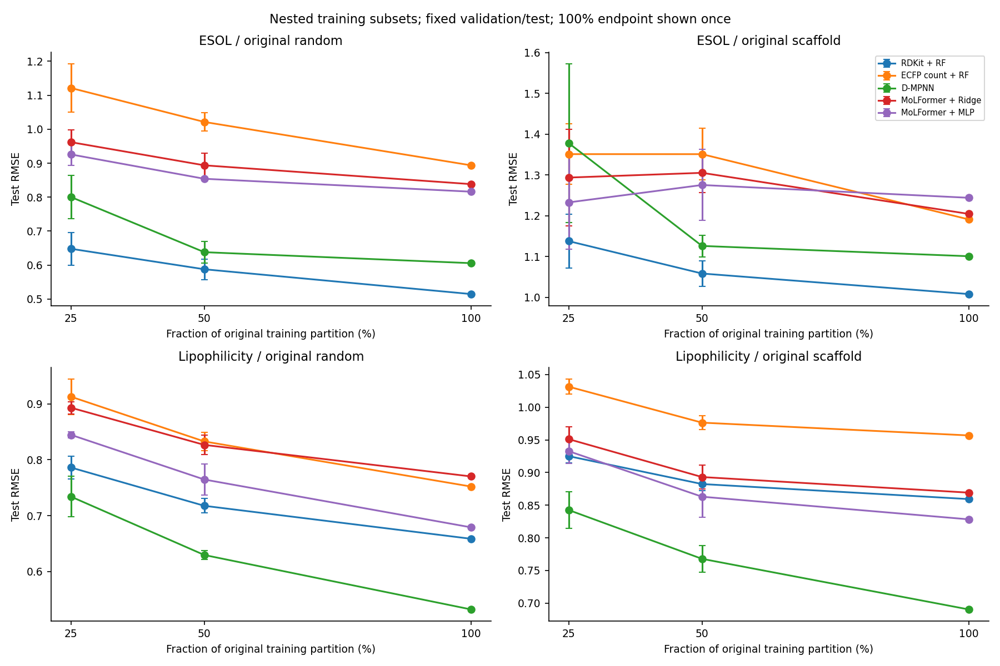

# DSC6020 · GNN 和 MoLFormer 预测分子性质

同样是预测水溶性，换一批分子做测试，第一名会变吗？我们在 ESOL 上试了三个新的随机分组划分，D-MPNN 三次的测试误差都最低。按分子骨架分组后，三个划分的第一名分别是 MoLFormer＋MLP、D-MPNN 和随机森林。

这次作业比较三类方法。随机森林（RF）读取从分子结构算出的描述符或指纹，D-MPNN 沿化学键传递信息，MoLFormer 从表示分子的字符串（SMILES）提取向量。我们固定了 MoLFormer 的参数，用 Ridge 或小型神经网络（MLP）把向量转换成性质预测值。每个设置里，各模型用的是同一批分子。

| 看什么 | 从哪里开始 |
|---|---|
| 了解实验怎么做、模型差多少 | [结果报告，含 RMSE 主表和六张图](RESULTS.md) |
| 查看某个划分的 RMSE 和 MAE | [逐划分成绩](analysis/cross_split_individual.csv) |
| 讨论汇报内容、认领任务 | [组内准备清单](TEAM.md) |
| 下载数据、逐分子预测或模型，自己核对 | [复现步骤](REPRODUCE.md) · [实验文件下载](https://github.com/WeihanChen000/dsc6020-molecular-property/releases/tag/study-v3) |

## 减少训练数据后，两个任务给出了不同结果

ESOL 有 1,128 条水溶性记录，Lipophilicity 有 4,200 条亲脂性记录。下图横轴是保留的训练数据比例，纵轴是测试 RMSE，越低越好。25% 和 50% 各取三个子集，共用验证集和测试集。100% 是同一训练种子的一次全量结果。

在五条主要模型路线中，ESOL 的 12 个小样本设置都由 RDKit 描述符＋RF 领先，Lipophilicity 的 12 个设置都由 D-MPNN 领先。同样取 25%，Lipophilicity 还有 840 条训练记录，远多于 ESOL。这里同时变了任务和样本数。

## MoLFormer 的预测头有多大影响？

固定同一组分子向量，新做的 12 个划分里，MLP 的测试 RMSE 全部低于 Ridge。换成 RDKit 描述符也能看到预测头的影响。在原来的四个全量设置里，RDKit＋MLP 的平均 RMSE 都低于 MoLFormer＋MLP。这个对照目前只覆盖原四个设置。[预测头对照表](analysis/head_representation_comparison.csv)

## 一个分子怎样影响整张成绩表

我们也试了把 RDKit 描述符和 MoLFormer 向量拼起来，一起交给 Ridge。16 个设置中，有 9 个同时超过了两种单独表征。但在 Lipophilicity 的一个随机划分里，420 个测试分子的 RMSE 达到 320,167.73。追到逐条预测，几乎全部平方误差来自同一个分子。它的实测值是 −0.94，模型却预测了约 656 万。把标准化后的描述符逐项乘回模型系数，可以看到几乎整个预测都来自远超训练范围的 `Ipc`。这个分子保留在所有结果里。[逐项系数与贡献](analysis/fusion_failure_contributions.csv) · [原始核验记录](analysis/fusion_failure_audit.json)

三轮实验沿用同一批 MoleculeNet 数据。旧测试成绩在后续实验开始前已经看过，新的随机骨架划分也会产生彼此重叠的测试集。这里的结论适用于这两项回归任务及当前的冻结模型配置。老师对自拟题的正式 benchmark 和 folds 仍待确认。[实验协议](study/实验协议.md) · [MoleculeNet 原论文](https://pubs.rsc.org/en/content/articlehtml/2018/sc/c7sc02664a)
