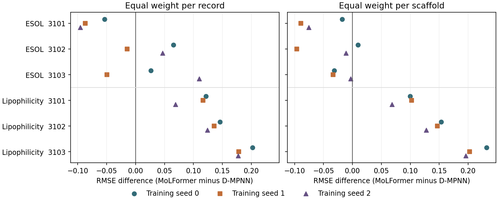

# 换一批分子骨架，GNN 和 MoLFormer 谁预测得更准？

我们先比较水溶性和亲脂性，再用第三个数据集 BACE 检验亲脂性上的排名能否延伸到酶抑制活性。D-MPNN 沿化学键传递信息。MoLFormer 读取分子的 SMILES 字符串，我们固定编码器，只训练一个小型回归网络。两条路线每次都预测同一批测试分子。

**到了 BACE-1 抑制活性，领先的模型换了。** 我们在训练前写下预测：如果亲脂性上的优势能延续，D-MPNN 在留出的新骨架上也应更准。实际测了 300 条记录，三个训练种子都是冻结 MoLFormer + MLP 的误差更低。按记录计分，它的 RMSE 为 0.718–0.750，D-MPNN 为 0.803–0.833。让 124 种测试骨架各占一票，仍是 MoLFormer 领先。三个种子用的是同一批骨架。[训练前锁定的协议与分区](https://github.com/WeihanChen000/dsc6020-molecular-property/commit/7bdeb2c6a2e404ab18d7f9ba2124e135dff2e341) · [BACE 逐次成绩](final/bace/results/scores.csv)

**在亲脂性上，D-MPNN 的优势经得住换种子。** 三批留出骨架，每批固定测试分子，把两个模型各训练三次。九次比较中，D-MPNN 的 RMSE 都更低。把计分单位从分子换成骨架，九次仍然都是 D-MPNN 领先。水溶性的结果更挑条件，尤其是含有大骨架组的测试集。

每行是一批测试分子，三个点是训练种子 0、1、2。点在零线右边，表示 D-MPNN 更准；在左边，表示冻结 MoLFormer + MLP 更准。亲脂性三批测试集合计覆盖 708 种不同骨架，水溶性覆盖 121 种。换种子时测试集保持固定。[分模型成绩和逐次差值](final/seeds/results/scores.csv) · [逐分子预测](final/seeds/results/predictions.csv)

**水溶性为什么容易换排名？** ESOL 的三批测试集各有 112 个分子，有一批单是联苯骨架就占了 39 个。若只用训练集的平均水溶性做预测，这一批的 RMSE 达到 3.447；在另外两批上只有 2.171 和 1.550。报告里保留了每批的均值基线，以及把每种骨架等权计分后的变化。[结果报告](RESULTS.md)

**一个描述符会带来多大影响？** RDKit 描述符接 MLP 本来是个有竞争力的对照，直到它把一个实测 logD 为 −0.94 的分子预测成约 7,665 万。删去 Ipc 这一列并从头训练后，该分子的预测降到 −13.27，仍是该组误差最大的分子。其余 419 个分子的 RMSE 略降，平均绝对误差却略升。[去 Ipc 的逐划分对照](final/results/ablation.csv)

[完整报告和 12 组成绩](RESULTS.md) · [逐分子预测](final/results/predictions.csv) · [五分钟复算一个结果](REPRODUCE.md) · [小样本、预测头和早期实验](RESULTS-v3.md) · [参考文献](REFERENCES.md)
