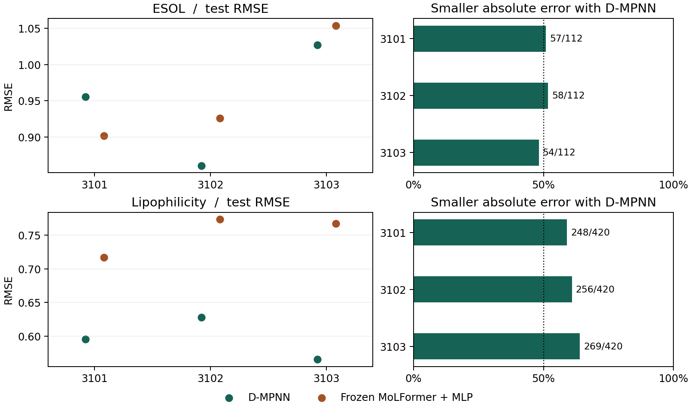

# 换一批分子骨架，GNN 和 MoLFormer 谁预测得更准？

我们用两个实验数据集比较分子性质预测。D-MPNN 沿化学键传递信息；MoLFormer 读取分子的 SMILES 字符串，我们固定编码器，只训练一个小型回归网络。两条路线每次都预测同一批测试分子。

在亲脂性数据（Lipophilicity）上，换三批训练中没出现过的骨架，D-MPNN 每次都在约六成分子上更接近实测值。在水溶性数据（ESOL）上，两个模型几乎各赢一半。

左图纵轴越低越好。右图虚线是 50%；数字是“D-MPNN 更准的分子数 / 该组测试记录数”。ESOL 三次共测到 280 条不同分子记录、121 种骨架，Lipophilicity 为 1,130 条、708 种骨架。三次测试有重叠。[覆盖范围与逐组计数](final/results/coverage.csv)

**水溶性为什么容易换排名？** ESOL 的三批测试集各有 112 个分子，有一批单是联苯骨架就占了 39 个。若只用训练集的平均水溶性做预测，这一批的 RMSE 达到 3.447；在另外两批上只有 2.171 和 1.550。报告里保留了每批的均值基线，以及把每种骨架等权计分后的变化。[结果报告](RESULTS.md)

**一个描述符会带来多大影响？** RDKit 描述符接 MLP 本来是个有竞争力的对照，直到它把一个实测 logD 为 −0.94 的分子预测成约 7,665 万。删去 Ipc 这一列并从头训练后，该分子的预测降到 −13.27，仍是该组误差最大的分子。其余 419 个分子的 RMSE 略降，平均绝对误差却略升。[去 Ipc 的逐划分对照](final/results/ablation.csv)

[完整报告和 12 组成绩](RESULTS.md) · [逐分子预测](final/results/predictions.csv) · [五分钟复算一个结果](REPRODUCE.md) · [小样本、预测头和早期实验](RESULTS-v3.md) · [参考文献](REFERENCES.md)
