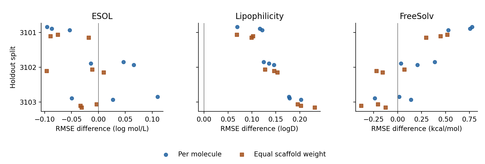

# 换一批分子骨架，GNN 和 MoLFormer 谁预测得更准？

三个物理性质给出了不同的答案。亲脂性上 D-MPNN 九次都领先；水溶性更挑测试骨架；新增的 FreeSolv 水合自由能上，D-MPNN 按分子算赢八次，按骨架算只赢四次。最后用 BACE 酶抑制活性作扩展，检查这两条路线到了生物活性任务上表现如何。

我们让 D-MPNN 从分子图学习，冻结 MoLFormer，把它读到的 SMILES 向量交给一个小型回归网络。两条路线在每个划分上都预测同一批测试分子，按验证集选参。以下比较测试 RMSE，越低越好。

| 任务 | 留出新骨架后发生了什么？ |
|---|---|
| Lipophilicity · 亲脂性 | 在三批测试骨架上各训练三次，D-MPNN 九次都领先，RMSE 比 MoLFormer 低 0.069–0.202。改成每种骨架各占一票，九次仍领先。 |
| ESOL · 水溶性 | 按分子计分，D-MPNN 赢 4/9；按骨架等权，它只赢 1/9。有一批测试集共 112 个分子，39 个属于同一种联苯骨架。 |
| FreeSolv · 水合自由能 | 三批留出骨架各跑三次。按分子算 D-MPNN 赢 8/9，按骨架等权赢 4/9。测试集分别有 31、29、17 种骨架，最大的两个骨架组始终在训练集。 |
| 生物活性扩展 · BACE | 普通骨架留出的 300 条记录上，MoLFormer 三次都更准，RMSE 为 0.718–0.750，D-MPNN 为 0.803–0.833。改为相似分子整组留出，按分子算 MoLFormer 赢 2/3，按骨架算赢 3/3。 |

三个面板分别是水溶性、亲脂性和水合自由能。横轴是 MoLFormer 减 D-MPNN 的 RMSE，正值表示 D-MPNN 更准。每种计分方式的三个点共用同一批测试分子，横轴单位随性质变化。[主报告](RESULTS.md#三项物理性质与-bace-扩展) · [FreeSolv 的四条路线、成本与覆盖](RESULTS.md#freesolv-的水合自由能) · [BACE 逐次成绩](final/bace/results/scores.csv)

## 和随机森林比，要花多少计算时间？

在三个骨架划分上固定训练种子 0，ESOL 的平均 RMSE 很接近，RDKit 描述符加随机森林（RF）为 0.943，D-MPNN 约 0.95，MoLFormer 约 0.96。亲脂性上三者分别为 0.760、0.596、0.753。BACE 普通骨架留出另用了训练均值与指纹最近邻作参照，RMSE 分别为 1.228 和 0.906。[随机森林、组随机划分与骨架划分的完整对照](RESULTS.md#随机森林与本机耗时)

在前两项任务的 12 个划分上，本机 CPU 累计拟合时间为 RF **225 秒**（36 次候选拟合）、D-MPNN **4,012 秒**（24 次）、MoLFormer 的回归头 **112 秒**（24 次）。回归头直接读已缓存的分子向量，首次编码另计。单独测过编码时间的 BACE 扩展中，冻结 Qwen 用 RTX 5060 Laptop 8 GB 编码 1,503 条 SMILES 耗时 **11.59 秒**。[按模型汇总的 CPU 计时](analysis/compute_inventory.csv) · [Qwen 编码与显存实测](final/bace/qwen/results/gpu.json)

## BACE 的标签会改变模型排名吗？

我们按化合物编号追溯原始测量。相似组测试集的 300 条记录里，268 条有明确 IC50 浓度，其余包含 Ki 和浓度限值等。用混合标签训练，再只给这 268 条评分，冻结 Qwen 三个种子都领先。训练和验证也只保留明确 IC50 后，同一批测试分子上种子 0 改由 MoLFormer 领先，种子 1、2 仍是 Qwen。两者的平均 RMSE 差从 0.069 缩至 0.012。筛选同时减少了训练样本，也改变了验证集选出的参数。[逐项测量核对](RESULTS.md#只在明确测得-ic50-的测试分子上评分) · [三模型同一测试集上的成绩](RESULTS.md#训练和验证也只用明确-ic50qwen-还能赢三次吗)

[五分钟复算一个结果](REPRODUCE.md#只用-python-看清-07330-从哪里来) · [小样本与预测头对照](RESULTS-v3.md) · [0638 和 0070 的个案附录](APPENDIX-0638.md) · [参考文献](REFERENCES.md)
