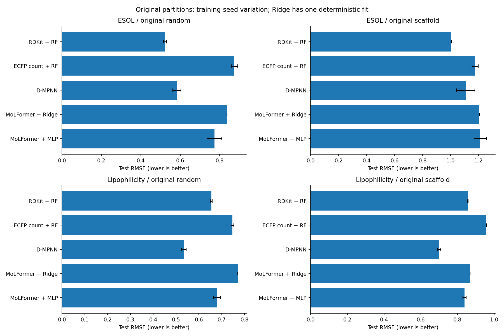
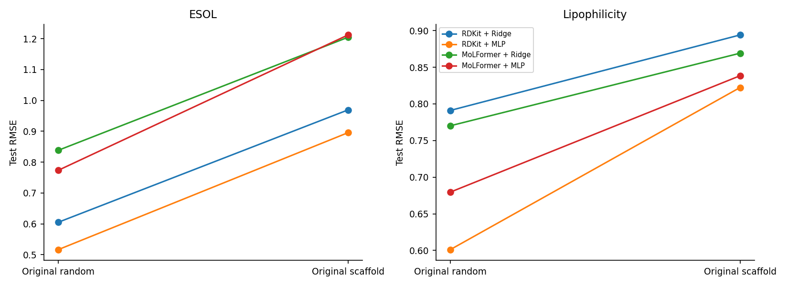
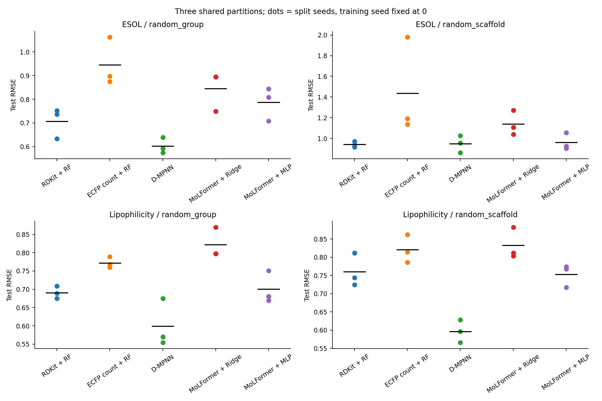
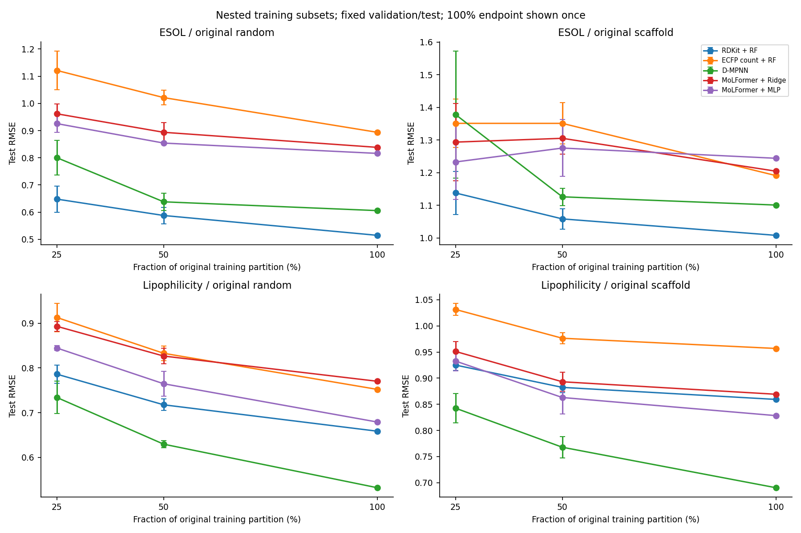
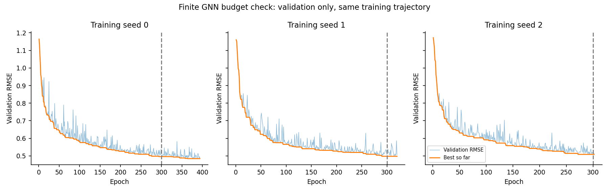
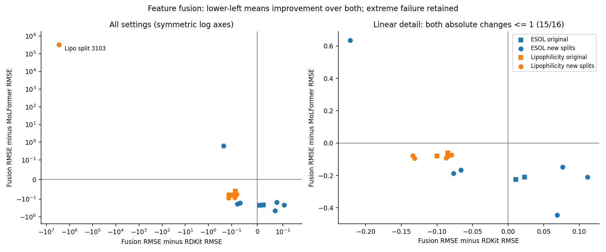

# 分子性质预测实验记录

ESOL 有 1,128 条实测对数水溶解度记录，Lipophilicity 有 4,200 条实测亲脂性记录。两项任务都用 RMSE 和 MAE 评价，分数越低，预测越接近实验值。模型共用相同的训练、验证和测试分子。下面分别列出原划分和后来新增划分的结果。

## 1. 原划分补充对照

下表为测试 RMSE，越低越好。RF、ECFP-RF、D-MPNN、两种 MLP 为三个训练种子的均值 ± 样本标准差，Ridge 为一次确定性拟合。所有路线共用原来的训练/验证/测试 ID。

| 数据集 | 划分 | RDKit + RF | ECFP count + RF | D-MPNN | MoLFormer + Ridge | MoLFormer + MLP |
|---|---|---|---|---|---|---|
| ESOL | random | 0.5231 ± 0.0076 | 0.8751 ± 0.0165 | 0.5829 ± 0.0206 | 0.8383 | 0.7735 ± 0.0375 |
| ESOL | scaffold | 1.0059 ± 0.0025 | 1.1760 ± 0.0220 | 1.1082 ± 0.0658 | 1.2046 | 1.2121 ± 0.0440 |
| Lipophilicity | random | 0.6546 ± 0.0041 | 0.7475 ± 0.0061 | 0.5343 ± 0.0106 | 0.7701 | 0.6796 ± 0.0154 |
| Lipophilicity | scaffold | 0.8567 ± 0.0023 | 0.9569 ± 0.0011 | 0.7002 ± 0.0088 | 0.8692 | 0.8384 ± 0.0089 |

两类表征 × 两种预测头的对照：

| 数据集 | 划分 | RDKit + Ridge | RDKit + MLP | MoLFormer + Ridge | MoLFormer + MLP |
|---|---|---|---|---|---|
| ESOL | random | 0.6051 | 0.5164 ± 0.0152 | 0.8383 | 0.7735 ± 0.0375 |
| ESOL | scaffold | 0.9692 | 0.8955 ± 0.0192 | 1.2046 | 1.2121 ± 0.0440 |
| Lipophilicity | random | 0.7911 | 0.6011 ± 0.0165 | 0.7701 | 0.6796 ± 0.0154 |
| Lipophilicity | scaffold | 0.8941 | 0.8224 ± 0.0029 | 0.8692 | 0.8384 ± 0.0089 |

这个矩阵减少了预测头选择的混杂，但没有完全隔离架构影响：RDKit 210 维、MoLFormer 768 维，对应 MLP 参数量分别为 27,137 与 98,561；D-MPNN 为 69,761。预训练历史也不同。ECFP count 为半径 2、2048 维计数指纹，RF 使用同样三个候选，但绝对候选特征数和训练耗时不同。比较这些分数时，需要一起考虑输入维度、参数量和调参预算。

描述符来源也已检查：210 个输入由 SMILES 经 RDKit CalcMolDescriptors 重新计算，未直接使用原始 ESOL 文件中的预测值或其他现成描述符列。MolWt、MolLogP、TPSA 等物化特征与任务有关，并不等于使用实验标签；但它们包含明确领域先验，不能称为与预训练模型信息来源完全对等。

## 2. 跨划分变化

下表仅含新 RandomGroup / RandomScaffold 的三个划分种子，训练种子固定为 0；标准差表示划分波动。旧确定性 Scaffold 不混入均值。不同划分测试集有重叠，三个值不构成独立总体样本或显著性证据。

| 数据集 | 划分 | RDKit + RF | ECFP count + RF | D-MPNN | MoLFormer + Ridge | MoLFormer + MLP |
|---|---|---|---|---|---|---|
| ESOL | random_group | 0.7076 ± 0.0648 | 0.9449 ± 0.1019 | 0.6022 ± 0.0335 | 0.8458 ± 0.0837 | 0.7869 ± 0.0700 |
| ESOL | random_scaffold | 0.9429 ± 0.0267 | 1.4353 ± 0.4713 | 0.9475 ± 0.0836 | 1.1393 ± 0.1195 | 0.9605 ± 0.0816 |
| Lipophilicity | random_group | 0.6907 ± 0.0172 | 0.7723 ± 0.0149 | 0.5995 ± 0.0657 | 0.8219 ± 0.0418 | 0.7005 ± 0.0440 |
| Lipophilicity | random_scaffold | 0.7599 ± 0.0458 | 0.8208 ± 0.0382 | 0.5963 ± 0.0313 | 0.8323 ± 0.0437 | 0.7530 ± 0.0309 |

逐划分 RMSE/MAE 见 analysis/cross_split_individual.csv；同一划分中的配对差值见 cross_split_paired_differences.csv。不能用不同测试集合上的均值差单独推断结构变化的因果作用。尤其在 Lipophilicity RandomGroup seed 3103，RF 与 D-MPNN 的 RMSE 为 0.674550 与 0.674767，差约 0.000217，且 GNN 最佳验证轮次为 298/300。这组结果近乎持平，训练上限也可能影响排序。

ESOL 新划分为 904/112/112；Lipophilicity 为 3360/420/420。ESOL 中无环骨架组 317 条和苯环骨架组 254 条超过单个测试分区容量，依训练前规则固定在训练集。随机骨架划分因此主要检验剩余骨架，不覆盖所有化学结构。三个 ESOL 骨架测试集的标签均值约为 −3.479、−5.345、−2.884，分布变化较大且未通过看分数重抽。

事后结构诊断也显示两种骨架协议不能混合：ESOL 旧骨架测试分子的最近训练相似度均值为 0.371，新随机骨架三组均值的平均为 0.440；Lipophilicity 对应为 0.497 与 0.563。新骨架测试在这个指纹度量下仍更接近训练样本，且标签/组组成不同。因此，不能把从旧划分到新划分的分数变化写成算法本身提高了结构泛化能力。

## 3. 小样本复核

25%/50% 各使用三个共享嵌套子集；模型训练种子固定 0，验证和测试 ID 固定。100% 端点只使用旧全量 seed 0 一次，ECFP 使用本轮 A 的 seed 0，不将这个端点重复当作三次独立测量。

ESOL

| 划分 | 训练量 | RDKit + RF | ECFP count + RF | D-MPNN | MoLFormer + Ridge | MoLFormer + MLP |
|---|---|---|---|---|---|---|
| random | 25% | 0.6479 ± 0.0480 | 1.1214 ± 0.0716 | 0.8002 ± 0.0643 | 0.9618 ± 0.0365 | 0.9257 ± 0.0322 |
| random | 50% | 0.5876 ± 0.0300 | 1.0214 ± 0.0268 | 0.6379 ± 0.0314 | 0.8937 ± 0.0363 | 0.8541 ± 0.0054 |
| random | 100% | 0.5146 | 0.8937 | 0.6056 | 0.8383 | 0.8161 |
| scaffold | 25% | 1.1379 ± 0.0665 | 1.3510 ± 0.0742 | 1.3780 ± 0.1944 | 1.2936 ± 0.1178 | 1.2328 ± 0.1142 |
| scaffold | 50% | 1.0586 ± 0.0310 | 1.3509 ± 0.0631 | 1.1262 ± 0.0267 | 1.3052 ± 0.0486 | 1.2754 ± 0.0868 |
| scaffold | 100% | 1.0083 | 1.1912 | 1.1010 | 1.2046 | 1.2441 |

Lipophilicity

| 划分 | 训练量 | RDKit + RF | ECFP count + RF | D-MPNN | MoLFormer + Ridge | MoLFormer + MLP |
|---|---|---|---|---|---|---|
| random | 25% | 0.7860 ± 0.0200 | 0.9128 ± 0.0316 | 0.7339 ± 0.0363 | 0.8930 ± 0.0110 | 0.8445 ± 0.0059 |
| random | 50% | 0.7175 ± 0.0129 | 0.8327 ± 0.0163 | 0.6295 ± 0.0079 | 0.8265 ± 0.0173 | 0.7646 ± 0.0280 |
| random | 100% | 0.6585 | 0.7520 | 0.5321 | 0.7701 | 0.6790 |
| scaffold | 25% | 0.9251 ± 0.0103 | 1.0315 ± 0.0116 | 0.8426 ± 0.0283 | 0.9511 ± 0.0191 | 0.9327 ± 0.0186 |
| scaffold | 50% | 0.8824 ± 0.0099 | 0.9764 ± 0.0103 | 0.7678 ± 0.0203 | 0.8931 ± 0.0184 | 0.8630 ± 0.0317 |
| scaffold | 100% | 0.8593 | 0.9568 | 0.6904 | 0.8692 | 0.8283 |

Lipophilicity 的训练量是 840/1680/3360，但每次还使用 420 条验证标签；ESOL 验证标签固定为 112 条。小样本结论是减少训练标签、保留固定验证预算的条件结果。相同比例在两个任务上对应不同的绝对样本数，因此跨任务差异不能全部归因于性质类型；若要隔离数量影响，还需另做相同绝对标签预算的实验。完整标签预算见 small_data_label_budget.csv；逐子集配对变化见 learning_curve_paired_changes.csv。

## 4. GNN 有限训练预算

固定 lr=0.0003，从三个种子重新训练；按验证规则最多延长到 450 轮，比较同一条训练轨迹上两种预算所选的模型。

| train_seed | rmse_budget300 | rmse_final | delta_rmse | best_epoch_final | epochs_run |
|---|---|---|---|---|---|
| 0 | 0.5254 | 0.5173 | -0.0080 | 364 | 394 |
| 1 | 0.5346 | 0.5346 | 0.0000 | 290 | 320 |
| 2 | 0.5281 | 0.5281 | 0.0000 | 272 | 302 |

三次都由早停结束，均未触及新上限。两个种子的最佳模型在 300 轮以内，延长没有改变选中模型；seed 0 的最佳轮次为 364，测试 RMSE 有小幅改善。它支持“旧预算可能截断部分收益”，不支持“延长训练必然提高泛化”。主结果和小样本端点仍使用原预算，方便与第二轮直接对照。

与第二轮相比，本次从头训练的轨迹并非逐点重现。budget_trajectory_comparison.csv 和 budget_sensitivity.csv 保存验证轨迹差异及预测差异；原因未被单独实验定位，不能断言全部来自浮点并行计算。预算效应以本次同一轨迹的检查点对照为准，避免将跨轮次差异归因于额外轮数。

## 5. 特征拼接的可选检验

可选阶段按资源条件执行：决策时可用内存 15.24 GiB，保守估计新增累计拟合时间 481.7 秒；条件未使用测试成绩。16 个预定设置中，拼接同时低于两个单独 Ridge 表征的 RMSE 有 9 个。

| dataset | split_type | context | descriptor_ridge | ridge | fusion_ridge | fusion_minus_rdkit | fusion_minus_lm |
|---|---|---|---|---|---|---|---|
| ESOL | random | ESOL_random_full | 0.6051 | 0.8383 | 0.6280 | 0.0229 | -0.2103 |
| ESOL | random_group | ESOL_random_group_split3101 | 0.6490 | 0.7491 | 0.5825 | -0.0665 | -0.1666 |
| ESOL | random_group | ESOL_random_group_split3102 | 0.7836 | 0.8941 | 0.7068 | -0.0768 | -0.1873 |
| ESOL | random_group | ESOL_random_group_split3103 | 0.6699 | 0.8942 | 0.7463 | 0.0764 | -0.1479 |
| ESOL | random_scaffold | ESOL_random_scaffold_split3101 | 1.8954 | 1.0389 | 1.6735 | -0.2219 | 0.6346 |
| ESOL | random_scaffold | ESOL_random_scaffold_split3102 | 0.7572 | 1.2714 | 0.8260 | 0.0687 | -0.4455 |
| ESOL | random_scaffold | ESOL_random_scaffold_split3103 | 0.7868 | 1.1075 | 0.8980 | 0.1112 | -0.2095 |
| ESOL | scaffold | ESOL_scaffold_full | 0.9692 | 1.2046 | 0.9800 | 0.0108 | -0.2246 |
| Lipophilicity | random | Lipophilicity_random_full | 0.7911 | 0.7701 | 0.6913 | -0.0998 | -0.0788 |
| Lipophilicity | random_group | Lipophilicity_random_group_split3101 | 0.8359 | 0.7978 | 0.7042 | -0.1317 | -0.0936 |
| Lipophilicity | random_group | Lipophilicity_random_group_split3102 | 0.8549 | 0.7976 | 0.7210 | -0.1339 | -0.0766 |
| Lipophilicity | random_group | Lipophilicity_random_group_split3103 | 3152262.0884 | 0.8701 | 320167.7302 | -2832094.3582 | 320166.8601 |
| Lipophilicity | random_scaffold | Lipophilicity_random_scaffold_split3101 | 0.7986 | 0.8029 | 0.7112 | -0.0874 | -0.0917 |
| Lipophilicity | random_scaffold | Lipophilicity_random_scaffold_split3102 | 0.8845 | 0.8825 | 0.7994 | -0.0851 | -0.0831 |
| Lipophilicity | random_scaffold | Lipophilicity_random_scaffold_split3103 | 0.8169 | 0.8115 | 0.7373 | -0.0796 | -0.0741 |
| Lipophilicity | scaffold | Lipophilicity_scaffold_full | 0.8941 | 0.8692 | 0.8094 | -0.0848 | -0.0598 |

负差表示拼接更好。必须同时比较 RDKit 与 MoLFormer：仅优于 MoLFormer 不足以证明互补优势。即使两者都超过，也只是该缩放、共同正则和下游预测器下的可利用信息证据，不证明编码器未编码某一化学性质。原四个划分与新十二个划分分别看，不把十六个重叠设置当独立统计样本。

**拼接不能作为稳定优于单一表征的默认方案。** ESOL 只有 2/8 个设置同时优于两种单独表征，其中原两个划分都只优于 LM、未超过 RDKit，和描述符主导的解释相容。Lipophilicity 有 7/8 个设置同时改善，但剩余一次是严重失效，不能仅报成功次数。

**可复核的失败：Lipophilicity RandomGroup 3103。** 拼接-Ridge 验证 RMSE 0.7009，测试 RMSE 却达 320,167.73；RDKit-Ridge 对应 0.7561 和 3,152,262.09。420 条测试样本中，Lipophilicity_03592 的实测值为 −0.94，两条预测分别约 656 万和 6,460 万，单条样本贡献各自几乎全部测试平方误差。该分子没有被删除，主表保留原分。

保存模型的逐项分解给出具体原因：该分子的 RDKit `Ipc` 为 7.12×10³⁰，训练最大值约 3.71×10²³。训练期标准化后的数值约 1.11×10⁹，乘以拼接模型的 Ipc 系数约 0.00589，单项就贡献约 656 万。用原始 SMILES 在上游默认数值设置下重新计算，复现了缓存；限制数值线程为 1/2/4/8 时结果落在 6.50–7.39×10³⁰，说明该描述符在此分子上的数值还对计算设置敏感，但所有结果均远超训练范围。该次拼接 alpha 为 1000，并非 Ridge 搜索下界，因此不能把失效完全归因于下界问题。

完整算术核查见 analysis/fusion_failure_audit.json 和 fusion_failure_contributions.csv。图左保留全部设置并使用对称对数坐标，图右放大 15 个两轴差值绝对值均不超过 1 的设置。后续可在新协议里比较预定的重尾描述符变换或训练期分位数截断，并验证是否引入其他损失；本轮未据此改模型、删行或重选参数。

## 6. 结构诊断与失败案例

analysis/error_examples.csv 保存原四设置中每个主模型 seed 0 的前三个绝对误差样本的并集，附所有主模型预测；选择规则透明，不能拿挑出的少数分子估计总体错误率。nearest_training_similarity.csv 和 similarity_error_groups.csv 使用半径 2、2048 位 Morgan 指纹做事后相似度诊断，与模型的 count 指纹表示区别记录。阈值沿用第二轮的 0.3/0.6，仅用于解释，不参与训练选参。

从第二轮已记录的高误差分子中取两个例子，再用原划分 seed 0 的已保存预测横向核对：

| 样本 | 实测值 | RDKit-RF | ECFP-RF | D-MPNN | LM-Ridge | LM-MLP | RDKit-MLP |
|---|---:|---:|---:|---:|---:|---:|---:|
| ESOL_00718（原 Scaffold） | −9.3320 | −7.9620 | −6.0090 | −10.1520 | −5.9611 | −4.9292 | −10.2064 |
| Lipophilicity_03148（原 Random） | −0.3800 | 1.8676 | 2.3945 | 2.1437 | 1.9566 | 3.2671 | 1.8554 |

第一个分子的 LM-MLP 误差较大，但 D-MPNN 在此例比 RDKit-RF 准，说明整体排名不能替代逐例比较。第二个分子六条路线都高估，其最近训练分子 Morgan 相似度约 0.241，提示它是值得继续核查的共同困难例；这不能证明结构稀疏就是唯一原因，更不能直接判定实验标签有误。两个目标值均处于各自训练标签范围以内，因此“标签超出训练范围”不能解释这两个例子。

这些是高误差案例，不是已证实的 activity cliffs 或化学机理。相似度组的标签分布和样本数也不同；最近相似度与误差关联不能单独证明因果解释。测试集重叠记录见 test_set_overlap.csv；按训练标签范围分组的事后诊断见 target_range_error_groups.csv。

## 7. 仍需保留的预算和证据限制

- 本轮选中神经模型的训练上限附近标记：1 个；详细 ID 见 verification_all.json。这些新划分/子集运行沿用预定预算，没有根据测试排名追试。
- Ridge 最优值落最终搜索边界：3 个；边界候选规则和完整验证记录保留。
- 只覆盖两个回归任务，不含分类；老师的正式 benchmark 和 folds 仍需确认。
- 冻结 MoLFormer 的预训练语料可能与下游分子重叠；“未见骨架”仅指当前下游训练集。
- 原划分的 RDKit-MLP 对照没有扩展到所有新划分，不能把其优势直接说成跨划分证实。
- 选参只用验证集，但研究设计受先前结果启发；这是如实标注的探索性研究，不能写作完全预注册的盲测。
- 各路线预训练、容量和搜索预算不同。完整拟合次数与计时见 compute_inventory.csv；并发情况下累计计时和墙钟不同，不作为严格速度排行榜。

实际阶段运行成本（本机 CPU，最多三个训练子进程）：

| stage | jobs | failed_jobs | wall_minutes | new_fits |
|---|---|---|---|---|
| A | 16 | 0 | 2.3287 | 72 |
| B | 12 | 0 | 29.8835 | 204 |
| C | 12 | 0 | 18.2524 | 204 |
| D | 3 | 0 | 11.0197 | 3 |
| E | 16 | 0 | 0.8017 | 196 |

wall_minutes 是阶段训练墙钟时间，包含启动和输出，不包含此前特征提取与阶段间核验/人工分析；new_fits 含全部候选和重复拟合。不同模型并发运行且停止轮数不同，不能据此做严格速度排名。

## 8. 文献支持与新意边界

[MoleculeNet](https://pubs.rsc.org/en/content/articlehtml/2018/sc/c7sc02664a)支持任务来源与统一评测思路，并不替代老师对自拟题的批准。[Yang 等的 D-MPNN 研究](https://arxiv.org/abs/1904.01561)说明固定描述符、学习表征和划分条件都值得比较，本项目使用成熟组件而非提出新架构。

[MoLFormer 原论文](https://arxiv.org/abs/2106.09553v3)区分冻结与微调；主回归结果不能直接拿来与本地冻结、10pct checkpoint 和不同划分排名。[Deng 等的系统评测](https://www.nature.com/articles/s41467-023-41948-6)已有物化描述符在 ESOL 较强、指纹形式与划分影响性能的先例，所以“描述符很强”本身不是本项目的新发现。

[Guo 等关于 Scaffold 的研究](https://arxiv.org/abs/2406.00873v2)提醒不同骨架仍可能结构相近；其虚拟筛选结论不能直接视为当前回归任务的效果证明。

[八篇参考文献及其与实验设计的关系](REFERENCES.md)
