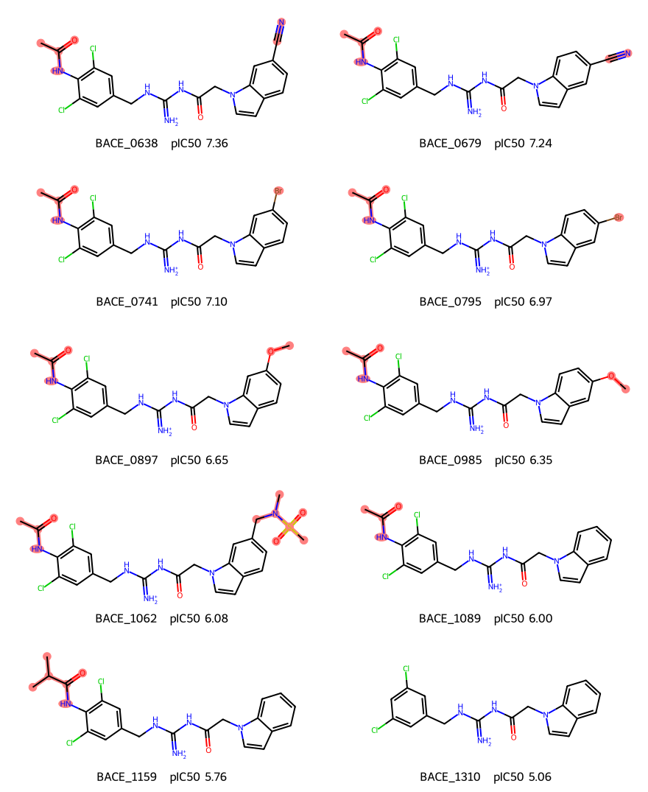
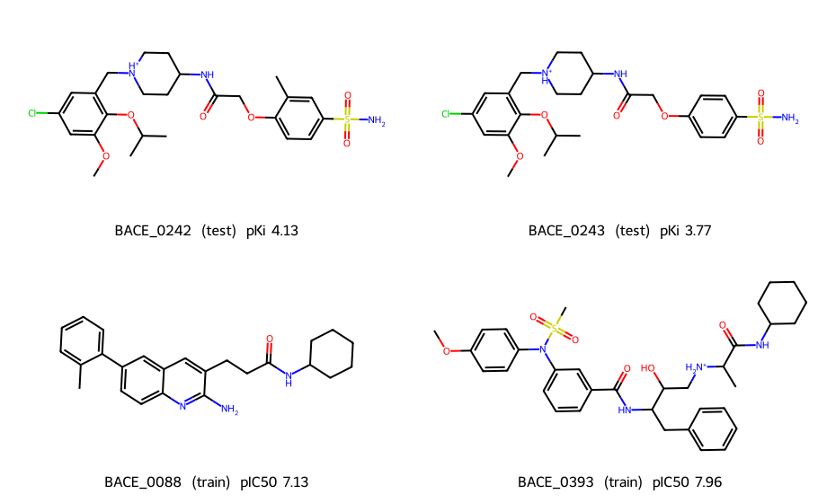
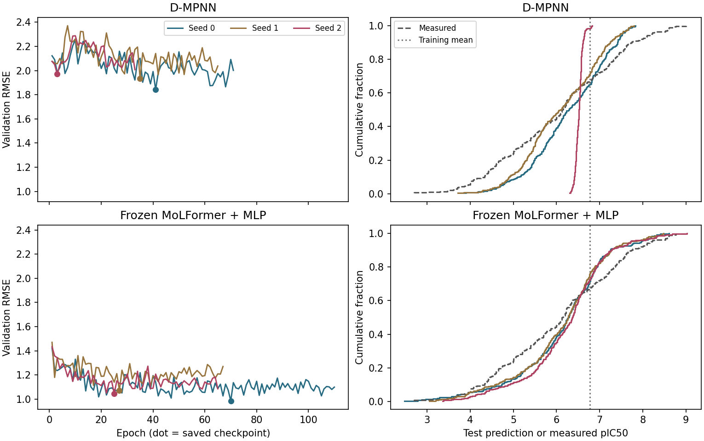
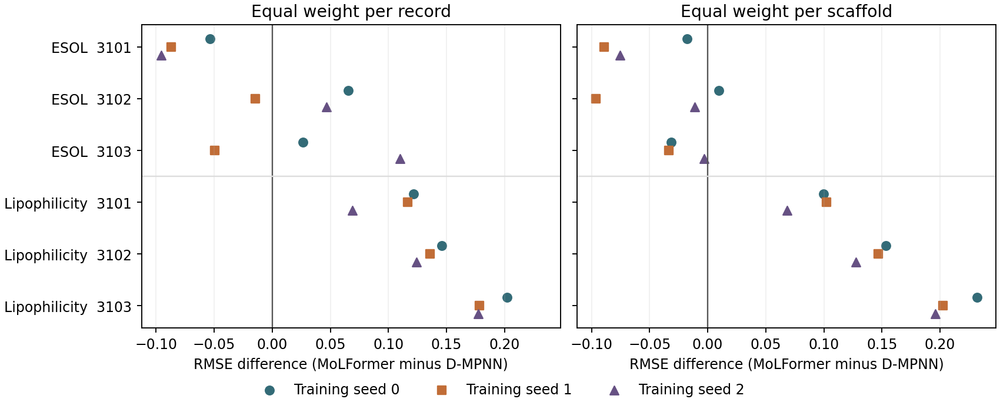

# 分子性质预测实验报告

我们先在 ESOL 和 Lipophilicity 上比较两条路线，一条用 Chemprop D-MPNN 从分子图学习，另一条固定 MoLFormer，用它的向量训练回归头。前两项任务分别预测实测水溶性（log mol/L）和亲脂性（pH 7.4 下的 logD），另设 RDKit 描述符对照。第三项任务换成 BACE-1 抑制活性。沿用数据集的 `pIC50` 列训练，逐条核对后发现这列还包含 Ki、Kd 和浓度界限。我们先比较两个模型和训练均值基线，后来又在相似组划分上补跑了通用语言模型 Qwen3-1.7B。

## 训练和验证也只用明确 IC50，Qwen 还能赢三次吗？

Qwen 赢了两次。上次三个模型用混合标签训练，只筛测试集，Qwen 在 268 条明确 IC50 上三次领先。这次从训练集去掉 61 条、验证集去掉 3 条，保留原分区的 992 条训练和 147 条验证记录；测试仍是原来的 268 条、163 种骨架。种子 0 改由 MoLFormer 领先，种子 1、2 仍是 Qwen 最准。

| 种子 | Qwen 混合训练 → IC50 训练 | MoLFormer 混合训练 → IC50 训练 | D-MPNN 混合训练 → IC50 训练 |
|---|---:|---:|---:|
| 0 | **1.020** → 1.116 | 1.155 → **1.067** | 1.085 → 1.337 |
| 1 | **1.022** → **1.081** | 1.067 → 1.116 | 1.102 → 1.314 |
| 2 | **1.046** → **1.029** | 1.074 → 1.079 | 1.314 → 1.453 |
| 三次平均 | **1.029** → **1.075** | 1.099 → 1.088 | 1.167 → 1.368 |

表中是逐分子 RMSE，粗体标出各训练方式下误差最低的模型。种子 0 的翻转来自两边：Qwen 的 RMSE 增加 0.096，MoLFormer 降低 0.088。三个种子平均，Qwen 对 MoLFormer 的优势从 0.069 缩到 0.012 pIC50。换用 MAE 或让每种骨架等权，重新训练后的逐次第一名仍依次是 MoLFormer、Qwen、Qwen。D-MPNN 三次误差都增大，平均 RMSE 增加 0.201。[三项评分与逐种子差值](final/bace/ic50_only/results/scores.csv) · [同一分子的新旧预测](final/bace/ic50_only/results/predictions.csv)

两个语言模型都固定编码器，只用缓存向量重新训练 MLP；D-MPNN 从头训练。各路线都先用种子 0 试两个学习率，再用验证集选出的学习率跑种子 1、2，共 12 次拟合、9 个入选模型。筛选后 Qwen 的入选学习率从 0.0003 变为 0.001，MoLFormer 和 D-MPNN 都从 0.001 变为 0.0003。D-MPNN 三个种子的验证最佳轮次分别是 6、8、1，均按早停规则结束。这里同时改变了样本构成、数量和验证集选出的参数，无法单独估计删去混合标签的作用。三次用的也是同一批测试分子，0.012 的平均差距只描述这次留出结果。[本地训练前固定的协议](final/bace/ic50_only/PROTOCOL.md) · [全部候选的验证成绩和停止轮次](final/bace/ic50_only/results/training.csv)

### 种子 0 为什么换成 MoLFormer 领先

**Qwen 跑到第 41 轮，最后用的是第 1 轮的权重。** 只用明确 IC50 训练后，种子 0 的 Qwen 在学习率 0.001 下，第一轮验证 RMSE 就到了 1.0614。随后 40 轮训练 MSE 从第 1 轮的 0.802 降到 0.121（标准化目标），验证 RMSE 却一直没低过第一轮，停止时是 1.4230。另一学习率 0.0003 训练了 164 轮，最好的第 124 轮也只有 1.2292。MoLFormer 两个候选更接近：0.0003 在第 57 轮达到 1.0854，略好于 0.001 在第 36 轮的 1.0895。按原规则，两者各自取验证误差较小的候选。

| 种子 | Qwen 最佳轮／停止轮 | MoLFormer 最佳轮／停止轮 | 验证 RMSE（Qwen／MoLFormer） | 测试 RMSE（Qwen／MoLFormer） |
|---|---:|---:|---:|---:|
| 0 | 1／41 | 57／97 | **1.061**／1.085 | 1.116／**1.067** |
| 1 | 7／47 | 32／72 | 1.381／**1.129** | **1.081**／1.116 |
| 2 | 58／98 | 87／127 | 1.280／**1.064** | **1.029**／1.079 |

验证集和测试集给两个模型的次序在三个种子下都相反。种子 0 的 147 条验证记录中，Qwen 只在 67 条上更准，但平方误差总和少了 7.58；其中 BACE_0193 一条就少了 11.38。回看混合训练，Qwen 与 MoLFormer 的种子 0 分别选中 0.0003 的第 47 轮和 0.001 的第 70 轮。把当时保存的两种学习率的最佳检查点都只在共有的 147 条验证记录上重算，两个模型各自的学习率选择仍与混合训练时一致。这能排除一个简单解释：仅在旧检查点的评分里去掉三条验证记录，不足以复现换学习率。现有记录能解释为何选中第 1 轮，却不能推断让 Qwen 再晚几轮取权重就会赢。[16 次候选的曲线摘要和验证复算](final/bace/ic50_only/seed_review/checkpoints.csv) · [入选模型逐条验证预测](final/bace/ic50_only/seed_review/validation.csv)

**哪些测试分子改变了排名？** 对每条分子用 Qwen 的平方误差减去 MoLFormer 的平方误差，正数表示 MoLFormer 更准。再用明确 IC50 训练后的差值减去混合训练时的差值，衡量这条分子让排名向哪边移动。下表按种子 0 向 MoLFormer 移动的幅度排序，右侧两列追踪同一分子在另外两次训练里的变化。

| 测试分子 | 种子 0 混合训练差值 | 种子 0 明确 IC50 差值 | 种子 0 变化 | 种子 1 变化 | 种子 2 变化 |
|---|---:|---:|---:|---:|---:|
| BACE_0202 | −0.23 | +13.30 | +13.53 | +1.17 | −1.26 |
| BACE_0512 | −7.80 | −0.64 | +7.16 | +0.68 | −0.15 |
| BACE_0192 | −0.51 | +6.43 | +6.93 | +1.35 | −4.04 |
| BACE_0105 | −7.23 | −0.67 | +6.56 | +1.26 | −0.82 |
| BACE_0723 | −6.79 | −1.20 | +5.59 | +1.29 | +0.58 |
| 全部 268 条合计 | −78.57 | +28.56 | **+107.13** | **+4.59** | **−12.08** |

BACE_0202 实测 2.699，种子 0 的 Qwen 预测从 3.573 变为 6.359，MoLFormer 则从 3.696 靠近到 3.011。BACE_0192 恰好相反，Qwen 把实测 3.509 低估到 0.876。另三条（0512、0105、0723）筛选训练后依旧是 Qwen 更准，只是原先的优势小了许多。有些难例在三个种子都出现，例如明确 IC50 训练后的 BACE_1383、1392 三次都是 MoLFormer 更准；但它们没有进入种子 0 排名变化最大的前五。[逐分子新旧预测、差值和变化量](final/bace/ic50_only/seed_review/molecules.csv)

**按骨架合并，影响最大的是含 BACE_0638 的十条记录。** 组内平方误差差值从 −5.84 变到 +10.52，向 MoLFormer 移动了 16.36；同组在种子 1、2 只移动了 +2.05、−1.32。其次是 0202 单独所在的骨架（+13.53），再是包含 0105 的两条记录（+12.15）。只看筛选训练后的最终差距，最大的三个骨架分别是 0202（+13.30）、0638（+10.52）和 0594 所在的七条（+7.22）。任何单一骨架的贡献都小于全体的 +28.56，单独去掉一组仍是 MoLFormer 领先。种子 1、2 最有利于 MoLFormer 的反而都是 0594 所在骨架（+18.36、+14.59），但其余分子合起来足以让 Qwen 领先。这里求组内总和是为了解释逐分子 RMSE，所有 268 条均计入正式成绩。[163 种骨架的成员数及三个种子的贡献](final/bace/ic50_only/seed_review/scaffolds.csv)

### BACE_0638 这组的十个分子

种子 0 的组内反超主要落在 **0638、0679、0741、0795** 上。沿用上一节的计分方式：逐条算 Qwen 平方误差减 MoLFormer 平方误差，再在组内求和。从混合训练换到明确 IC50 训练，这个差从 −5.84 变为 +10.52。四条贡献了 +16.08，占全组净变化 +16.36 的 98.3%。其余六条合计 +0.28，个别影响方向相反，相加后大多抵消。

下表的实测和预测均为 pIC50。每格先列 Qwen，再列 MoLFormer。最后一列按未取整的预测计算，正数表示改用明确 IC50 训练后，差距向 MoLFormer 移动。三个种子在两种训练方式下的全部预测另附在表后。

| BACE 编号 | 实测 | 混合训练，种子 0 | 明确 IC50，种子 0 | 明确 IC50，种子 1 | 明确 IC50，种子 2 | 种子 0 差值变化 |
|---|---:|---:|---:|---:|---:|---:|
| 0638 | 7.36 | 5.97 / 4.94 | 5.25 / 5.49 | 5.98 / 5.34 | 5.82 / 5.30 | +4.85 |
| 0679 | 7.24 | 6.13 / 5.03 | 5.26 / 5.41 | 6.01 / 5.26 | 5.95 / 5.37 | +4.23 |
| 0741 | 7.10 | 5.60 / 5.96 | 4.94 / 6.84 | 5.84 / 6.00 | 5.81 / 6.44 | +3.65 |
| 0795 | 6.97 | 5.81 / 5.96 | 5.05 / 6.75 | 5.87 / 5.95 | 5.92 / 6.33 | +3.35 |
| 0897 | 6.65 | 5.61 / 6.39 | 5.49 / 5.73 | 5.05 / 6.23 | 5.00 / 5.17 | −0.52 |
| 0985 | 6.35 | 5.37 / 6.21 | 5.34 / 5.46 | 5.13 / 6.17 | 5.40 / 5.25 | −0.71 |
| 1062 | 6.08 | 6.72 / 6.79 | 6.06 / 7.14 | 6.83 / 6.55 | 6.33 / 6.78 | −1.04 |
| 1089 | 6.00 | 5.41 / 6.43 | 4.45 / 6.36 | 5.25 / 5.35 | 5.34 / 6.09 | +2.09 |
| 1159 | 5.76 | 5.50 / 6.38 | 4.89 / 6.32 | 5.69 / 5.36 | 5.46 / 5.81 | +0.77 |
| 1310 | 5.06 | 4.40 / 6.37 | 5.28 / 6.34 | 4.93 / 5.65 | 5.12 / 6.19 | −0.30 |

**真正从 Qwen 更准变为 MoLFormer 更准的是 0638、0679 和 1159。** 前两条在种子 0 都被两个模型低估：换训练数据后，Qwen 的预测更低，MoLFormer 的预测升高。0741、0795 原本就是 MoLFormer 更准。这两条占明确 IC50 训练后最终差距的最大两项（+4.62、+3.66），因为 MoLFormer 已接近实测值，Qwen 却把两条都估在 5 左右。1062 的变化方向相反，Qwen 的 6.06 接近实测 6.08，MoLFormer 却高估到 7.14。[三个种子的实测值、新旧预测和误差贡献](final/bace/ic50_only/scaffold_0638/predictions.csv)

**四条共享什么特征？** 十条都来自同一篇论文，原始记录都是有等号的 IC50，范围为 0.044–8.75 µM。结构也可以逐个对齐：十条都有二氯苄基、带正电的酰基胍和吲哚环。贡献最大的四条在二氯苯环上都带乙酰氨基；在吲哚环上，0638、0679 各带一个氰基，0741、0795 各带一个溴，各对仅取代位置不同。它们恰好是实测活性最高的四条，IC50 依次为 44、57、79、106 nM。相同两个位置换成甲氧基的 0897、0985 实测为 224、450 nM，种子 0 的变化反而分别为 −0.52、−0.71。[结构、化合物编号和原始浓度](final/bace/ic50_only/scaffold_0638/structures.csv)

**种子 1、2 没有重复这次反超。** 同样四条在这两个种子下分别只带来 +0.60、+0.92 的净变化。明确 IC50 训练后，两条氰基分子都由 Qwen 更准，两条溴取代分子仍由 MoLFormer 更准。十条合计的平方误差差分别为 −0.23、−2.71，都是 Qwen 略低。高活性和这两种取代在这四条上重合，现有预测能定位到这几个样本，但不能分清是活性范围还是取代结构导致了种子 0 的误差。

### 0638 以外的高活性分子也被低估了吗？

是。用 992 条明确 IC50 训练记录的平均 pIC50（6.806）作分界，268 条测试记录有 83 条高于这个值。种子 0 的 Qwen 低估了其中 77 条，平均误差为 −1.059 pIC50；其余 185 条的平均误差为 +0.161。把 0638 整个骨架排除后，高活性记录还剩 79 条，Qwen 低估了 73 条；按骨架分别求平均误差，49 种里有 46 种偏低。把分界提高到训练集上四分位数（7.638），骨架外剩下的 27 条全部被低估。这里讨论的是明确 IC50 训练后的模型，所有误差均按“预测减实测”计算。[全部记录与各组的计数、偏差和 RMSE](final/bace/ic50_only/high_activity/summary.csv)

| 模型、种子 | 高活性 83 条：低估数／平均误差 | 排除 0638 骨架后 79 条：低估数／平均误差 | 氰基和溴取代 4 条：平均误差 | 异骨架匹配对照 12 条：平均误差 |
|---|---:|---:|---:|---:|
| Qwen 0 | 77／−1.059 | 73／−1.009 | −2.045 | −0.892 |
| Qwen 1 | 76／−0.835 | 72／−0.814 | −1.242 | −0.597 |
| Qwen 2 | 77／−0.870 | 73／−0.848 | −1.296 | −0.689 |
| MoLFormer 0 | 78／−0.866 | 74／−0.857 | −1.045 | −0.797 |
| MoLFormer 1 | 81／−1.069 | 77／−1.046 | −1.531 | −0.895 |
| MoLFormer 2 | 77／−0.857 | 73／−0.834 | −1.309 | −0.879 |

**相同活性，换个骨架会怎样？** 给四条各配三条测试对照，只按实测 pIC50 的距离挑选。排除了目标所在的整个结构相似组，12 个对照各用一种不同的 Murcko 骨架。目标与对照最大的活性差为 0.039 pIC50，六次模型比较共用同一份名单。

| 目标 | 测试对照（均省略 BACE_） | 种子 0 Qwen 对目标的误差 | 对三条对照的平均误差 |
|---|---|---:|---:|
| 0638（氰基） | 0070、0628、0648 | −2.106 | −0.709 |
| 0679（氰基） | 0080、0694、0078 | −1.981 | −0.851 |
| 0741（溴） | 0093、0738、0757 | −2.165 | −1.283 |
| 0795（溴） | 0101、0805、0784 | −1.926 | −0.727 |

0638 和 0070 实测都是 7.357。种子 0 的 Qwen 给前者 5.250，给后者 7.300；MoLFormer 分别给出 5.491、6.800。四条目标的低估幅度均大于各自三个对照的平均值。放宽到目标活性 ±0.10 内的所有组外记录，每条可找到 8–15 条，种子 0 的 Qwen 在四个目标上仍都低估得更多。种子 1、2 的 Qwen 也低估高活性分子，但四条目标与匹配对照的平均误差相差约 0.65、0.61，均小于种子 0 的 1.15。[每一对的实测值和两模型三次预测](final/bace/ic50_only/high_activity/matched_predictions.csv) · [放宽活性窗口后的对照](final/bace/ic50_only/high_activity/paired_bias.csv)

**四条对全体排名有多大影响？** 种子 0 在 83 条高活性记录上的平方误差总和，Qwen 比 MoLFormer 多 32.68；四条贡献 9.81（约 30%），其余 79 条贡献 22.87。在较低活性的 185 条上 Qwen 追回 4.12。合并全部 268 条，Qwen 仍多 28.56；即使去掉整个 0638 骨架，仍多 18.04。上节的 98.3% 指这四条占**该骨架从混合训练换到明确 IC50 训练时的净变化**，分母与这里不同。因而这组最突出的是低估幅度。这个单次划分里的高活性低估跨越许多骨架，两种模型都有；四条来自同一骨架，匹配也只控制了活性，无法由此确定氰基或溴对模型误差的独立作用。

## 只在明确测得 IC50 的测试分子上评分

在相似组留出的 300 条记录上，种子 0 的 RMSE 最低的是 Qwen，种子 1、2 是 MoLFormer。只给有明确 IC50 浓度值的 268 条打分后，三个种子都由 Qwen 领先。以下两套成绩用的是同一批已保存的预测，训练数据、回归头和早停轮次均沿用原实验。

**1,503 条标签的来源。** 我们按化合物 CID 对回作者的 SDF，核对测量类型、关系符、浓度和单位。下表各行互斥。明确 IC50 要求原记录写明 IC50、关系符为等号、有正的浓度数值和可换算的单位。对于能换算的 1,486 条记录，取摩尔浓度的负对数，与发布标签的最大绝对差约为 0.000030。[逐条标签清单](final/bace/qwen/assay_audit/labels.csv) · [作者补充数据](https://doi.org/10.1021/acs.jcim.6b00290.s001)

| 原始测量 | 训练 | 验证 | 测试 | 合计 |
|---|---:|---:|---:|---:|
| IC50，有等号、浓度和单位 | 992 | 147 | 268 | 1,407 |
| IC50，有等号但缺原始浓度值 | 16 | 0 | 1 | 17 |
| IC50，只有浓度下限（>） | 21 | 3 | 11 | 35 |
| Ki，有等号 | 17 | 0 | 18 | 35 |
| Kd，有等号 | 6 | 0 | 2 | 8 |
| Cell，有等号 | 1 | 0 | 0 | 1 |
| 全部 | 1,053 | 150 | 300 | 1,503 |

35 条限值全部写作 IC50 大于某个浓度，换成 pIC50 后是上界。全划分中，小于某个浓度的记录为 0。另有 17 条虽然标了等号、也有发布的对数标签，原始浓度值却空缺，其中 14 条连单位也空缺。测试集只涉及 BACE_0069 一条；将它纳回按 269 条评分，三个种子的 RMSE 排名仍与 268 条时相同。[分区计数](final/bace/qwen/assay_audit/counts.csv) · [含 269 条对照的评分表](final/bace/qwen/assay_audit/scores.csv)

**同一批预测，换一批评分记录。** 表中是逐分子 RMSE，数值越低越好。完整测试集覆盖 183 种骨架，筛选后覆盖 163 种。

| 种子 | 全部 300 条 Qwen | MoLFormer | D-MPNN | 明确 IC50 的 268 条 Qwen | MoLFormer | D-MPNN |
|---|---:|---:|---:|---:|---:|---:|
| 0 | **1.169** | 1.228 | 1.188 | **1.020** | 1.155 | 1.085 |
| 1 | 1.183 | **1.158** | 1.203 | **1.022** | 1.067 | 1.102 |
| 2 | 1.207 | **1.163** | 1.399 | **1.046** | 1.074 | 1.314 |
| 三次平均 | 1.186 | **1.183** | 1.264 | **1.029** | 1.099 | 1.167 |

看 MAE，两个口径下都是 Qwen 三次领先。让每种保留的骨架各占一票，明确 IC50 子集的三个种子也都是 Qwen 的 RMSE 最低。种子 0 下，D-MPNN 在这个子集排第二；种子 1、2 则是 MoLFormer 第二。[三个指标的逐次成绩](final/bace/qwen/assay_audit/scores.csv)

**哪部分误差改变了排名？** 种子 1 在 268 条明确 IC50 上，Qwen 的平方误差总和比 MoLFormer 少 25.53；在 18 条 Ki 上却多 19.39，在 11 条只有下限的 IC50 上又多 22.87。把所有类别加回去，Qwen 总共多 17.80。种子 2 在明确 IC50 上少 15.86，在 Ki 和限值记录上分别多 34.81、14.87，全体合计多 31.07。此前追踪的八条难例中，0242、0243 属于 Ki，1464、1466、1484 是限值；1383、1392、1454 仍计入这次评分。[各测量类别的平方误差](final/bace/qwen/assay_audit/squared_errors_by_type.csv)

这个结果说明，报告模型排名时需要交代测试集里的测量类型。本次只改变了评分对象，所有模型仍使用混合标签训练；筛选也改变了受评的分子和骨架。三个种子共享这批样本，无法把排名变化单独归因于测量类型，更不能由此推断用纯 IC50 重新训练后的排名。

## 冻结 Qwen 和 MoLFormer 在同一批 BACE 分子上表现如何

我们给两个模型相同的 SMILES，预测实测 pIC50。在原有的相似组划分里，1,053 条记录用于训练，150 条用于选学习率和早停，余下 300 条覆盖 183 种骨架。Qwen3-1.7B 保持冻结，取最后一层有效 token 的平均向量，再用 MLP 输出数值；MoLFormer 沿用原实验保存的冻结向量和测试预测。两个回归头都有 128 个隐藏单元，学习率各试两个。Qwen 的输入为 2,048 维，回归头有 262,401 个参数；MoLFormer 的输入为 768 维，回归头有 98,561 个参数。两者的分词和向量提取方式也不同。[预先提交的实验协议](https://github.com/WeihanChen000/dsc6020-molecular-property/commit/d0c9190) · [Qwen 权重版本](https://huggingface.co/Qwen/Qwen3-1.7B/tree/70d244cc86ccca08cf5af4e1e306ecf908b1ad5e)

| 训练种子 | Qwen RMSE | MoLFormer RMSE | Qwen MAE | MoLFormer MAE | Qwen 骨架等权 RMSE | MoLFormer 骨架等权 RMSE |
|---|---:|---:|---:|---:|---:|---:|
| 0 | 1.169 | 1.228 | 0.907 | 0.983 | 1.208 | 1.253 |
| 1 | 1.183 | 1.158 | 0.909 | 0.933 | 1.214 | 1.190 |
| 2 | 1.207 | 1.163 | 0.939 | 0.950 | 1.247 | 1.201 |
| 三次均值 | 1.186 | 1.183 | 0.918 | 0.955 | 1.223 | 1.215 |

三次测试用的都是同一批分子。按原先选模型的指标 RMSE，两者平均只差 0.0034 pIC50，逐次排名会变；若每种骨架等权，逐次胜负也一样。两个模型在三个种子下的 RMSE 都低于直接预测训练均值的 1.521。[完整评分表](final/bace/qwen/results/scores.csv) · [同划分的均值基线](final/bace/similarity/results/scores.csv)

为什么 Qwen 三次的 MAE 都更低，RMSE 却只赢一次？逐条看，Qwen 的预测比 MoLFormer 更靠近实测值的记录分别有 166、169、164 条，占各轮 300 条中的过半。再看各模型误差最大的 30 条，种子 2 下 Qwen 的平均绝对误差是 2.622，MoLFormer 是 2.377；种子 1 下分别为 2.591、2.403。RMSE 对这些大偏差更敏感。这里的 30 条由各模型各自的误差排序得到，用于解释成绩，选参时没有使用。[逐分子预测](final/bace/qwen/results/predictions.csv)

**在 8 GB 笔记本显卡上实际花多久？** RTX 5060 Laptop 加载已下载的权重用时 2.33 秒，随后用 11.59 秒编码全部 1,503 条 SMILES，每批 8 条，最长 146 个 token，全程无需截断。PyTorch 峰值分配 3,348 MiB，峰值预留 3,388 MiB。开始前整卡已用 1,421 MiB，运行期间 40 次读数最高 4,940 MiB，整卡读数包含桌面和其他进程。缓存向量后，CPU 用 4 个线程完成四次回归头拟合和选参记录，共 11.93 秒。上述三个阶段合计约 26 秒，未计下载、校验文件、准备数据、解释器启动和最终评分。本轮复用了 MoLFormer 旧预测，因此只报告 Qwen 的本机耗时。[GPU 原始读数](final/bace/qwen/results/gpu.json) · [各次训练记录](final/bace/qwen/results/training.csv)

这批结果支持把冻结 Qwen 留作通用语言模型对照。我们只试了一个已公开成绩的划分和一种 Qwen 池化方式。三个种子衡量的是回归头训练波动，不能说明换一批测试分子后谁会领先，也无法从这个实验推断通用模型和分子模型的预训练各贡献了多少。全程没有使用提示词生成数值，也没有做 QLoRA。[从权重重算](REPRODUCE.md) · [向量和回归头下载](https://github.com/WeihanChen000/dsc6020-molecular-property/releases/tag/study-v9)

### 哪些分子拉高了 Qwen 的 RMSE？

种子 1、2 里，Qwen 相对 MoLFormer 误差增加最多的前十个分子有八个相同：BACE_0242、0243、1383、1392、1454、1464、1466、1484。这里按每条分子的“Qwen 平方误差减 MoLFormer 平方误差”从大到小排。这样既考虑 Qwen 错了多少，也考虑 MoLFormer 在同一条上错了多少。若只按 Qwen 自身的绝对误差排，两次最差的 30 条也有 24 条重合。[全部 300 条的逐种子排名](final/bace/qwen/error_review/molecules.csv)

**这八条分属七种骨架，只有 BACE_0242 和 BACE_0243 共享骨架。** 把同骨架所有记录的平方误差差值加起来，这两条组成的骨架在三个种子里都排第一。BACE_0243 的标签是 3.77（原始测量换算的 pKi），种子 0、1、2 下，Qwen 分别预测 7.32、7.40、7.67，MoLFormer 分别预测 5.47、6.26、5.61。另一个反复出现的分子 BACE_1392 属于另一种骨架，实测为 4.60，Qwen 三次都预测到 7.82–7.90，MoLFormer 给出 6.19–6.33。把 183 种骨架按总贡献排名，每个种子的前五名都有三组相同，分别包含 BACE_0242、1392、1383。[骨架排名、组大小与完整骨架 SMILES](final/bace/qwen/error_review/scaffolds.csv)

**种子 0 也碰到了同样的难点。** 八条中有七条也进了种子 0 的前十。下表把这八条和其余 292 条分开，列出各组的平方误差总和之差。正数表示 Qwen 误差更大，两列直接相加就能解释全体 300 条的 RMSE 排名。

| 种子 | 共同的 8 条 | 其余 292 条 | 全部 300 条 |
|---|---:|---:|---:|
| 0 | +51.75 | −94.17 | −42.42 |
| 1 | +47.16 | −29.36 | +17.80 |
| 2 | +56.02 | −24.95 | +31.07 |

种子 0 在其余 292 条上省下的平方误差足以抵消这八条的损失；种子 1、2 在其余记录上仍占优，但优势小了。这八条是看完种子 1、2 的预测后挑出来的，只用来解释本次排名。正式成绩保留全部 300 条。[按这两组复算的 RMSE](final/bace/qwen/error_review/shared_cases.csv)

**高低活性的偏差能解释多少？** 沿用前文的训练集均值 6.775 作分界。八条共同难例都在低活性一侧。扩大到全部 203 条低活性记录和 97 条高活性记录后，两个模型三个种子都平均高估低活性、低估高活性。下表是平均有符号误差（预测减实测，单位 pIC50）。

| 种子 | 低活性 Qwen | 低活性 MoLFormer | 高活性 Qwen | 高活性 MoLFormer |
|---|---:|---:|---:|---:|
| 0 | +0.619 | +0.585 | −0.857 | −0.974 |
| 1 | +0.729 | +0.528 | −0.771 | −0.941 |
| 2 | +0.626 | +0.673 | −0.857 | −0.870 |

种子 1 的 Qwen 在低活性组平均高估更多，平方误差总和比 MoLFormer 多 58.73，高活性组追回 40.93。种子 2 的情况不同。两个模型各有 147/203 条低活性预测偏高，Qwen 的平均高估还略小，但少数较大的误差让它在低活性组多出 34.31 的平方误差，高活性组只追回 3.24。这些预测能定位误差，还不足以断定哪种化学结构导致了偏差。[分组计数、偏差与平方误差差值](final/bace/qwen/error_review/activity.csv)

### 八个低活性分子在训练集里有多像的参照？

BACE_0242 和 0243 只差一个芳环甲基。两者的 Morgan 指纹相似度为 0.822，在同一测试组。相互之间很像，但在 1,053 条训练记录中，各自能找到的最高相似度只有 0.232 和 0.219。0242 的近邻 0088 有芳环和酰胺，缺少这对分子的含氯芳环、哌啶和磺酰胺；0243 的近邻 0393 也有磺酰胺和芳环，但带正电的胺在开链上。只凭这些局部相似处，训练集给不出一个接近原骨架的参照。

**先核对纵轴。** 项目沿用 BACE CSV 的 `pIC50` 列评分。查回作者的结构数据文件，0242、0243 分别是同一篇论文中的化合物 14、13，记录的是 Ki = 74、170 µM。换算为 pKi 才得到 4.13、3.77；两个训练近邻 0088 和 0393 记录的则是 IC50。0242 比 0243 的实测对数活性高 0.36，Qwen 三次都把顺序排反了，同时把两者都估得过高。其余难例中，1464、1466 的原始记录是 IC50 > 100 µM，1484 是 IC50 > 200 µM；对应的 4.00、4.00、3.70 是对数活性的上界。按 CSV 算出的高估幅度，对这三条已经是保守估计。[八条原始测量与来源](final/bace/qwen/training_neighbors/source.csv) · [作者补充数据](https://doi.org/10.1021/acs.jcim.6b00290.s001)

| 测试 ID（省略 BACE_） | 数据集标签 | 指纹最近的训练 ID | Tanimoto | 训练近邻标签 | Qwen 预测 | MoLFormer 预测 |
|---|---:|---|---:|---:|---:|---:|
| 0242 | 4.13 | 0088 | 0.232 | 7.13 | 7.28 | 5.68 |
| 0243 | 3.77 | 0393 | 0.219 | 7.96 | 7.46 | 5.78 |
| 1383 | 4.65 | 1324、1326 | 0.489 | 5.00、5.00 | 7.60 | 6.46 |
| 1392 | 4.60 | 0042 | 0.513 | 7.82 | 7.86 | 6.28 |
| 1454 | 4.15 | 1323 | 0.534 | 5.00 | 7.10 | 5.83 |
| 1464 | 4.00 | 1139 | 0.479 | 5.82 | 7.09 | 6.05 |
| 1466 | 4.00 | 0042 | 0.460 | 7.82 | 6.81 | 5.47 |
| 1484 | 3.70 | 0181、1488 | 0.321 | 4.38、3.70 | 6.15 | 4.91 |

预测取三个回归头种子的平均值。最能看出两类编码差别的是 0242、0243：用冻结向量的余弦相似度找训练近邻，Qwen 为两条找出的前五名连顺序都一样，五条标签平均 **8.05**。MoLFormer 的前五名里出现了活性较低的训练分子，两组均值分别为 **7.11、6.66**。但训练集中也有反例。1454 的指纹近邻标签为 5.00，Qwen 向量的最近邻却是 0042（7.82）；1484 甚至有一个并列指纹近邻与它的发布标签同为 3.70。把八条的高估全归因于缺少低活性训练参照，解释不了这两条。[三种方法的前五近邻、并列项与模型输入 SMILES](final/bace/qwen/training_neighbors/neighbors.csv)

**与其余低活性分子相比。** 八条的最近指纹相似度中位数是 0.469，其余 195 条是 0.365。缺少近似结构对 0242、0243 尤其明显，却不是八条共同的特征。为减少活性高低本身带来的差别，我们又从这 195 条中给每个难例配一个标签最接近的对照，联合匹配且不重复使用分子。下表先对每条记录取三个种子的平均预测，再取组内中位数。

| 测试记录 | 标签 | Qwen 高估值（预测减标签） | MoLFormer 高估值 | Qwen 向量前五近邻的平均标签 | MoLFormer 向量前五近邻的平均标签 |
|---|---:|---:|---:|---:|---:|
| 八条难例 | 4.07 | +3.02 | +1.68 | 7.47 | 6.24 |
| 其余 195 条低活性记录 | 5.51 | +0.45 | +0.55 | 6.68 | 6.06 |
| 其中八条活性匹配对照 | 4.04 | +2.25 | +1.49 | 7.20 | 5.98 |

同样弱的分子也常被 Qwen 高估。匹配后，两组 Qwen 高估值的中位数差由 2.57 缩到 0.77。八条难例来自三篇论文，训练集中都查不到相同的 PMID。其余 195 条低活性记录有 183 条注明 PMID，其中 143 条同样查不到同篇训练记录。现有数据更支持这样的解释：在 0242、0243 这对分子上，结构参照少，Qwen 表征中最接近它们的又恰好都是强活性分子。回归头用整个训练集学习，近邻只用来检查表征，不能据此断定模型照搬了某条标签，或把误差归到某个官能团上。八条难例按测试误差事后选出，三个种子共享同一批冻结向量。[低活性记录明细](final/bace/qwen/training_neighbors/low_activity.csv) · [八对匹配记录](final/bace/qwen/training_neighbors/matched.csv)

## 亲脂性上的排名能延伸到 BACE-1 抑制活性吗？

**这批新骨架给出了相反的排名。** 如果 D-MPNN 在亲脂性上的优势能延续，三个训练种子按记录、按骨架计分都应是它领先，并优于只报训练均值的基线。这是训练前写下的判据。结果六项比较全由冻结 MoLFormer + MLP 领先，两条路线都好于均值基线。[训练前的提交](https://github.com/WeihanChen000/dsc6020-molecular-property/commit/7bdeb2c6a2e404ab18d7f9ba2124e135dff2e341)

| 训练种子 | 按记录 RMSE，D-MPNN | 按记录 RMSE，MoLFormer | 按骨架 RMSE，D-MPNN | 按骨架 RMSE，MoLFormer | D-MPNN 绝对误差较小的记录 |
|---|---:|---:|---:|---:|---:|
| 0 | 0.8052 | 0.7183 | 0.9174 | 0.7773 | 149 / 300 |
| 1 | 0.8026 | 0.7499 | 0.8827 | 0.7769 | 155 / 300 |
| 2 | 0.8327 | 0.7370 | 0.9337 | 0.7840 | 146 / 300 |

如果对所有分子都预测训练集的平均活性，按记录计分的 RMSE 是 1.2282，按骨架计分是 1.3883。

逐条看，两种模型各有约一半预测更接近实测值。差距在大偏差上更明显。以种子 0 为例，绝对误差超过 1.5 个 pIC50 单位的记录，D-MPNN 有 22 条，MoLFormer 有 7 条。这是看完成绩后的描述。改看对大偏差较不敏感的 MAE，三个种子也都是 MoLFormer 较低（0.567–0.588，对应 D-MPNN 的 0.617–0.639）。[逐条预测](final/bace/results/predictions.csv) · [全部指标](final/bace/results/scores.csv)

**这批分子怎么选？** 我们先核对候选集与旧数据的分子连接结构。FreeSolv 的 642 条记录排除重叠后剩 270 条。BACE 的 1,513 条只需排除 10 条，剩下的记录有 667 种骨架，也把预测对象从物理化学性质换成了酶抑制活性。按无手性骨架整组划分，训练、验证、测试分别有 1,053、150、300 条记录。测试集覆盖 124 种训练中未见的骨架，最大的一组占 55 条。按骨架计分时，先在每组内算均方误差，再对 124 组取平均、开平方。[分区成员](final/bace/partitions.csv) · [BACE 回归数据说明](https://deepchem.readthedocs.io/en/latest/api_reference/moleculenet.html#deepchem.molnet.load_bace_regression)

两条路线各试两个学习率，只用验证 RMSE 选参。D-MPNN 选中 0.001，MoLFormer 回归头选中 0.0003。各自固定学习率再训练种子 1、2，共拟合八次。全部选定后，重载六个模型，对同一批测试分子评分。冻结编码器完整读入了全部 1,503 条分子字符串，最长 176 个 token，未遇到词表外 token。[八次训练记录](final/bace/results/training.csv) · [评分与输入核验](final/bace/results/verification.json)

三个任务放在一起，亲脂性上 D-MPNN 的优势经得住换种子，ESOL 的排名随划分和计分方式变化，而在这批 BACE 骨架上冻结 MoLFormer 更准。三次训练只检验重新训练带来的波动，BACE 只留出过一批骨架。两条路线都用 BACE 训练标签重新拟合，MoLFormer 预训练语料与 BACE 的结构重叠程度也未知。由此能判断本次模型排名换了方向，还无法判断究竟是预训练、表征还是数据构成造成了差异。

### BACE 测试分子离训练集有多远？

看过主结果后，我们用与前两项任务相同的指纹设置和相似度分档，给每条测试记录找最像的训练分子。采用半径 2、2,048 位的 Morgan 位指纹，用 Tanimoto 系数衡量相似度。300 条中有 258 条的最高相似度至少为 0.6，40 条在 0.3 到 0.6 之间，只有 2 条低于 0.3。一个具体例子是测试记录 BACE_0063 和训练记录 BACE_0046。前者的环上碳链多一个碳，骨架不同，两者的位指纹却完全相同。这批数据适合讨论换骨架后的表现，对远离训练结构的分子则证据很少。[每条测试记录及其最近邻](final/bace/review/neighbors.csv)

如果直接把最近训练分子的实测 pIC50 当作预测，按记录计分的 RMSE 为 **0.9058**，按骨架计分为 **0.9616**。43 条测试记录有并列最近邻，我们对并列训练记录的活性取平均。这个方法比只报训练均值更准，两个神经模型在三个种子下又都比它更准。相似度分档和最近邻只用于事后分析。[分档样本量及成绩](final/bace/review/scores.csv)

我们也检查了最大的骨架组会不会左右排名。预测固定，每次从测试集中去掉一种骨架，让其余 123 种重新计分。将 124 种骨架逐个去掉，三个种子下 MoLFormer 都仍然领先。按记录计分，D-MPNN 减去 MoLFormer 的 RMSE 差值最小还有 **0.0354**，按骨架等权最小为 **0.0881**。这说明单独移除任意一组都不足以翻转排名。若整批测试骨架换掉，仍需另做实验。[逐骨架删组结果](final/bace/review/omit_one_scaffold.csv)

### 把相似分子整组留出以后

原骨架划分只有两条测试记录的最近邻相似度低于 0.3。于是我们对同一批 BACE 分子再划分一次。如果两条记录骨架相同，或 Morgan 位指纹的 Tanimoto 相似度至少为 0.6，就把它们连起来。通过其他分子间接连通的记录也留在同一区。1,503 条记录形成 116 组，训练、验证、测试仍然各有 1,053、150、300 条。测试集分到 69 组，最大的一组有 44 条，合计 183 种骨架。分区名单与八次拟合的预算都在训练前公开。[训练前的协议和分区](https://github.com/WeihanChen000/dsc6020-molecular-property/commit/36d9378fa45ca2598f491c699a67074e5bcc5699)

| 测试记录相对各自训练集的最近邻相似度 | 原骨架划分 | 相似组留出 |
|---|---:|---:|
| 均值 / 中位数 | 0.709 / 0.720 | 0.383 / 0.394 |
| 最高值 | 1.000 | 0.595 |
| 低于 0.3 | 2 | 98 |
| 至少 0.3、低于 0.6 | 40 | 202 |
| 至少 0.6 | 258 | 0 |

新旧划分都试了相同的两个学习率。新划分上，两条路线按验证 RMSE 都选中 0.001，随后各自固定学习率再训练两次。下表每格依次给出 **D-MPNN / 冻结 MoLFormer + MLP** 的测试 RMSE，单位为 pIC50，越低越好。

| 训练种子 | 原划分，按记录 | 新划分，按记录 | 原划分，按骨架 | 新划分，按骨架 |
|---|---|---|---|---|
| 0 | 0.8052 / 0.7183 | **1.1880** / 1.2283 | 0.9174 / 0.7773 | 1.2584 / **1.2533** |
| 1 | 0.8026 / 0.7499 | 1.2035 / **1.1576** | 0.8827 / 0.7769 | 1.2814 / **1.1902** |
| 2 | 0.8327 / 0.7370 | 1.3993 / **1.1629** | 0.9337 / 0.7840 | 1.5105 / **1.2006** |

**按预定规则，排名只在部分条件下保持。** 换到新划分，两个模型在每个种子下的按记录 RMSE 都升高。种子 0 按记录计分时 D-MPNN 更准，按骨架等权时 MoLFormer 领先约 0.005。种子 1、2 的两种计分都是 MoLFormer 更准。三次训练均复用同一批测试记录。[逐次 RMSE 与 MAE](final/bace/similarity/results/scores.csv) · [逐分子预测](final/bace/similarity/results/grouped_predictions.csv) · [验证选参与早停](final/bace/similarity/results/training.csv)

这次同时改变了训练成员和测试成员。原划分的训练、测试 pIC50 均值分别为 6.58 和 6.53，新划分分别为 6.77 和 6.06。即使只报训练均值，按记录算的 RMSE 也从 1.2282 升到 1.5209。单独看两次都进入测试集的 58 条记录，两个模型在新划分下的 RMSE 也都升高，但它们学习过的训练分子仍然不同。相似结构变少、活性分布变化与训练成员变化各自贡献多少，这次对照无法分开估计。[分区标签统计](final/bace/similarity/results/partitions_summary.csv) · [共同测试记录的成绩](final/bace/similarity/results/shared_test.csv) · [最近邻分档成绩](final/bace/similarity/results/similarity_band_scores.csv)

单看新划分里相似度低于 0.3 的 98 条记录，种子 0 的 RMSE 为 1.331 对 1.428，D-MPNN 较低；种子 1 和 2 分别为 1.370 对 1.251、1.562 对 1.232，冻结 MoLFormer 较低。这个分档给出了较远结构上的实际误差，种子之间仍会换排名。

### 种子 0 为什么换个计分单位就换了排名？

固定同一批 300 条预测，按记录算 RMSE，D-MPNN 为 1.1880，MoLFormer 为 1.2283。按骨架算，分别是 1.2584 和 1.2533。这里计分的是 **183 种 Murcko 骨架**；划分时整组留出的 69 个相似组承担的是划分数据的作用。

在测试集中，135 种骨架各出现一次，其余 48 种共有 165 条记录。前一批合起来是 MoLFormer 更准，后一批合起来是 D-MPNN 更准。按记录计分时，前一批只占 135/300（45.0%）；给每种骨架相同权重后，它们占 135/183（73.8%）。表里把这次权重变化换算成了误差差值。为让两行能直接相加，先用均方误差（MSE），最后开平方才得到 RMSE。差值按 D-MPNN 减 MoLFormer 计算，正数表示 MoLFormer 更准。

| 测试骨架 | 骨架数 / 记录数 | 对按记录 MSE 差的贡献 | 对按骨架 MSE 差的贡献 |
|---|---:|---:|---:|
| 只出现一次 | 135 / 135 | +0.0551 | +0.0903 |
| 出现两次及以上 | 48 / 165 | −0.1525 | −0.0775 |
| 全部（用未取整数求和） | 183 / 300 | **−0.0974** | **+0.0128** |

两条具体记录能看出权重怎样起作用。BACE_0638 所在骨架有 10 条记录，D-MPNN 和 MoLFormer 在这个骨架内的 MSE 分别为 0.490 和 1.593。按骨架计分后，整组的权重从 10/300 降到 1/183，D-MPNN 在这里积累的优势随之缩小。BACE_0202 则独占一种骨架，实测 pIC50 为 2.70，D-MPNN 预测 6.08，MoLFormer 预测 3.70。它的权重从 1/300 升到 1/183，MoLFormer 在这个分子上少犯的误差占了更大比重。也有相反的例子：BACE_0939 所在的七条记录整体更有利于 MoLFormer，给这个骨架降权反而帮了 D-MPNN。[183 种骨架的完整误差贡献](final/bace/similarity/weights_review/seed0_scaffolds.csv)

**0.0051 的骨架等权 RMSE 差有多稳？** 我们保持预测不动，每次去掉一种骨架再给剩下的记录评分。按记录计分，183 次都是 D-MPNN 领先。按骨架等权，170 次仍由 MoLFormer 领先，有 13 次换成了 D-MPNN。用同样的办法检查种子 1 和 2，去掉任意一种骨架，两种计分都仍由 MoLFormer 领先。这是看过结果后的敏感性检查，正式成绩保留全部骨架。现有预测解释了种子 0 的总分如何翻转；至于模型为什么在某个化学结构上预测得更好，这些误差本身还不能给出机制解释。[三个种子的逐骨架删除检查汇总](final/bace/similarity/weights_review/seed_sensitivity.csv)

### 哪 13 种骨架能让种子 0 换排名？

逐一删去骨架时，种子 0 有 13 次从 MoLFormer 领先变成 D-MPNN 领先。这 13 组有一个由筛选规则决定的共同点。把每个骨架内的 MSE 差记为 D-MPNN 减 MoLFormer，183 个差值之和是 +2.3512。每次删去一个骨架，剩余差值的总和若要变成负数，删掉那组的差值就必须大于 2.3512。因此，真正值得追问的是这 13 组的活性、结构和换种子后的表现。[13 组名单与三个种子的影响](final/bace/similarity/weights_review/flip13.csv)

| 同一测试集内的比较，每种骨架计一次 | 会翻转的 13 种 | 其余 170 种 |
|---|---:|---:|
| 测试记录数 / 其中只出现一条记录的骨架数 | 17 / 10 | 283 / 125 |
| 骨架平均 pIC50 与训练均值 6.775 的绝对距离，中位数 | 1.807 | 1.154 |
| 各骨架内先平均最近邻相似度，再取中位数 | 0.278 | 0.400 |
| 骨架重原子数 / 环数，各自的中位数 | 23 / 3 | 23 / 4 |

**共同的误差模式出现在活性两端。** 种子 0 下，这 13 种骨架中，7 种的平均活性低于训练均值，D-MPNN 估高了；另外 6 种高于训练均值，它又估低了。其余 170 种里也有 132 种的偏差朝这个方向。13 组的平均活性通常离训练均值更远，训练集中能找到的近邻也通常更远。它们分布在 11 个相似组，含单条记录的比例与其余组接近（77% 对 74%）。这些都是按种子 0 的误差筛选后观察到的特征，不能据此把翻转归因于某一类环系或低相似度。[两批骨架的统计](final/bace/similarity/weights_review/flip_cohorts.csv)

**哪些骨架对总排名影响最大？** 下表先算两模型的骨架等权 RMSE 差（D-MPNN 减 MoLFormer），再减去删掉该骨架后的差值。正数表示保留这个骨架会扩大 MoLFormer 的相对优势，负数表示更有利于 D-MPNN，单位均为 pIC50。三列用同一批骨架，ID 是组内的一条代表记录。

| 代表记录 | 种子 0 | 种子 1 | 种子 2 | 三次训练中看到的变化 |
|---|---:|---:|---:|---|
| BACE_0202 | +0.0229 | +0.0257 | +0.0259 | 三次都是正向影响第一 |
| BACE_0203 | +0.0192 | +0.0183 | +0.0208 | 三次都是正向影响第二 |
| BACE_0034 | +0.0137 | +0.0163 | +0.0013 | 前两次排第三，种子 2 降到第 49 |
| BACE_0194 | +0.0097 | +0.0074 | +0.0160 | 种子 2 升到第三 |
| BACE_0545 | −0.0162 | −0.0100 | −0.0074 | 种子 0 中反方向影响最大 |
| BACE_0220 | −0.0155 | −0.0165 | −0.0156 | 种子 1、2 中反方向影响最大 |

BACE_0202 和 BACE_0203 各自独占一种骨架，汇编表中的 pIC50 均为 2.699。三个种子下，D-MPNN 对这两条记录都估高了 3.38–3.96 个单位，MoLFormer 也估高，但偏差较小。它们一直影响总分，只有在种子 0 能各自翻转排名。原因可以直接比较：种子 0 的原始领先只有 0.0051，远小于删去 BACE_0202 带来的 0.0229 变化；种子 1、2 的领先分别为 0.0912、0.3099，都大于各自最有影响的一组。固定种子 0 选出的这 13 种，种子 1 在组内 MSE 上仍是 MoLFormer 全部较低，种子 2 则为 12 种较低，唯一例外是 BACE_0241。三次训练共用同一个测试集，这里比较的是重新训练后影响是否还在。[全部 183 种骨架的双向排序与删组差值](final/bace/similarity/weights_review/scaffold_influence.csv)

### 全部 300 条预测有多少朝训练均值偏？

在相似组留出的测试集，203 条记录的 pIC50 低于新训练集均值 6.775，97 条高于它。对前一批，我们数预测值高于实测值的记录；对后一批，数预测值低于实测值的记录。这回答偏差朝哪个方向。预测有时会跨过均值，所以最后一列另算预测值到 6.775 的距离确实小于实测值到 6.775 的距离。各行都是同一批 300 条，每条权重相等。

| 模型 | 种子 | 低活性估高 / 203 | 高活性估低 / 97 | 偏差朝均值 / 300 | 预测值更靠近均值 / 300 |
|---|---:|---:|---:|---:|---:|
| D-MPNN | 0 | 152 | 91 | 243（81.0%） | 211（70.3%） |
| D-MPNN | 1 | 140 | 93 | 233（77.7%） | 198（66.0%） |
| D-MPNN | 2 | 191 | 97 | 288（96.0%） | 273（91.0%） |
| 冻结 MoLFormer + MLP | 0 | 145 | 87 | 232（77.3%） | 190（63.3%） |
| 冻结 MoLFormer + MLP | 1 | 130 | 90 | 220（73.3%） | 183（61.0%） |
| 冻结 MoLFormer + MLP | 2 | 147 | 89 | 236（78.7%） | 200（66.7%） |

两个模型在三个种子下都倾向于高估低活性、低估高活性，D-MPNN 每个种子都更频繁。种子 2 差距最大：D-MPNN 对 97 条高活性记录全部估低，平均低估 1.04 个 pIC50 单位；对低活性记录平均高估 1.18。MoLFormer 在相同两批上的平均偏差分别为 −0.87、+0.67。若把此前会引起排名翻转的 13 种骨架全部剔除（17 条记录），剩余 283 条中，按种子 0、1、2 顺序，D-MPNN 朝均值偏的仍有 226、216、271 条，MoLFormer 有 216、204、219 条。正式评分保留全部记录。这项事后统计描述偏差的方向；若对所有记录都报训练均值，方向计数也会达到 100%，评价准确程度仍应看 RMSE 和 MAE。[各分组的计数、平均偏差和 MAE](final/bace/similarity/weights_review/mean_pull.csv)

### D-MPNN 种子 2 为什么把高低活性都预测到 6.5 附近？

**测试用的是第 3 轮的模型，训练实际跑到了第 33 轮。** 第 3 轮的验证 RMSE 是 1.970，此后连续 30 轮都没有更低，触发了预先设定的早停规则。训练集上的标准化 MSE 从第 3 轮的 0.973 降到第 33 轮的 0.420，同期验证集上最好的后续成绩只有 2.007。种子 0 在第 3 轮的验证 RMSE 也很接近（1.984），但后来在第 41 轮降到 1.843。两次训练的差别在于，种子 0 后来还有验证集认可的改进。

| 模型 | 种子 | 验证最佳轮 / 实际停止轮 | 最佳验证 RMSE | 测试预测均值 | 测试预测标准差 | 距训练均值不超过 0.5 的条数 / 300 |
|---|---:|---:|---:|---:|---:|---:|
| D-MPNN | 0 | 41 / 71 | 1.843 | 6.270 | 0.869 | 110 |
| D-MPNN | 1 | 35 / 65 | 1.934 | 6.089 | 0.887 | 106 |
| D-MPNN | 2 | **3 / 33** | 1.970 | **6.518** | **0.083** | **300** |
| 冻结 MoLFormer + MLP | 0 | 70 / 110 | 0.985 | 6.138 | 1.091 | 123 |
| 冻结 MoLFormer + MLP | 1 | 27 / 67 | 1.073 | 6.111 | 1.061 | 118 |
| 冻结 MoLFormer + MLP | 2 | 25 / 65 | 1.045 | 6.232 | 0.979 | 135 |

相同的 300 条实测值均值为 6.058，样本标准差为 1.344，只有 67 条落在训练均值 6.775 的 ±0.5 范围内。D-MPNN 种子 2 的预测中心比训练均值低 0.257，最小值和最大值分别为 6.306 和 6.823。203 条低活性记录的实测均值是 5.329，97 条高活性记录是 7.583，两批的平均预测却只有 **6.507 和 6.539**。高活性记录中最低的实测值（6.8069）也高于这批记录里最高的预测（6.8061），所以 97 条全部估低。同一个检查点在 150 条验证记录上也给出很窄的分布，预测标准差同为 0.083。

左图的圆点是保留的模型，曲线末端才是实际停止轮次。右图的红线是种子 2，越陡说明预测越集中。为了看清输出中心和分子间差异各起了什么作用，我们做了一个事后计算：对所有测试分子都报训练均值 6.775，RMSE 为 1.521；都报种子 2 的平均预测 6.518，RMSE 已降到 1.418；恢复它的逐分子预测后，RMSE 为 1.399。在这批测试记录上，相对训练均值基线的 MSE 改善约 85% 来自这个整体下移。

从现有记录能确认，验证集选中了一个很早、输出范围很窄的检查点。归档只保留最佳权重及其预测，后续各轮留下的是汇总损失。第 33 轮的预测是否会拉开、延长训练是否会提高测试精度，都无法从这些曲线推断。种子同时影响参数初始化和训练批次顺序，这次对照也无法把两者的作用拆开。[六条早停记录](final/bace/similarity/weights_review/early_stops.csv) · [验证与测试预测的分布](final/bace/similarity/weights_review/prediction_spread.csv)

### BACE_0202 和 BACE_0203 为什么都是 2.6989701？

这两个项目 ID 来自 DeepChem 原表从零开始的行号。按原表的 CID 回查 2016 年作者补充包中的 bace1547.sdf，两条记录能分别对上不同论文的不同化合物。两行的 IC50 都登记为 2000 µM，关系字段都是等号，换算后 −log₁₀(2000 × 10⁻⁶) ≈ 2.69897。相同标签在模型训练和数据划分之前就已存在。[作者公开补充数据](https://doi.org/10.1021/acs.jcim.6b00290.s001) · [两条记录的原字段](final/bace/similarity/weights_review/pair_source.csv)

| 项目 ID | 原表 CID | 原研究标识 | 活性数值能核实到哪里 |
|---|---|---|---|
| BACE_0202 | BACE_204 | Murray 等，2007，化合物 5，PDB 2OF0 | 汇编登记为 2000 µM。本次核实了结构和文献对应关系，原实验的不确定度仍未知。[结构与原文入口](https://www.rcsb.org/structure/2OF0) |
| BACE_0203 | BACE_205 | Godemann 等，2009，化合物 8，PDB 3HVG | 原论文图 3 标为约 2 mM，标准差 0.6 mM。汇编保留了中心值。[原论文第 10745 页，图 3](https://d-nb.info/1313816760/34#page=3) |

所以这两个分子的**建模标签相同**，实验记录支持的是毫摩尔量级的活性。pIC50 的七位小数来自对数换算，两项实验精确到同一数值的说法超出了来源能支持的范围。我们沿用公开标签评分。

## 换训练种子后，亲脂性的优势还在吗？

在三批 Lipophilicity 测试骨架上，D-MPNN 每次训练都比冻结 MoLFormer + MLP 更准。每批有 420 条测试记录，D-MPNN 在其中 233 至 269 条上的绝对误差更小。按分子等权计算，九次 RMSE 优势为 0.0691–0.2024；按骨架等权计算，优势为 0.0685–0.2317。给小骨架组和大组同样的权重后，结论仍然成立。

图中横轴是 MoLFormer 的 RMSE 减去 D-MPNN 的 RMSE。左边每条测试记录占相同权重；右边先算各骨架内的均方误差，再让每种骨架等权平均，最后开平方。表中为同一划分三次训练各自 RMSE 的均值 ± 样本标准差。

| 数据集 | 骨架划分 | 分子等权 D-MPNN | 分子等权 MoLFormer | 骨架等权 D-MPNN | 骨架等权 MoLFormer |
|---|---:|---:|---:|---:|---:|
| ESOL | 3101 | 0.971 ± 0.013 | 0.892 ± 0.011 | 1.040 ± 0.026 | 0.979 ± 0.017 |
| ESOL | 3102 | 0.891 ± 0.039 | 0.924 ± 0.003 | 0.964 ± 0.045 | 0.931 ± 0.019 |
| ESOL | 3103 | 1.034 ± 0.010 | 1.063 ± 0.072 | 0.990 ± 0.009 | 0.967 ± 0.018 |
| Lipophilicity | 3101 | 0.604 ± 0.015 | 0.707 ± 0.015 | 0.642 ± 0.015 | 0.732 ± 0.011 |
| Lipophilicity | 3102 | 0.635 ± 0.013 | 0.770 ± 0.006 | 0.665 ± 0.019 | 0.808 ± 0.008 |
| Lipophilicity | 3103 | 0.577 ± 0.012 | 0.763 ± 0.008 | 0.596 ± 0.012 | 0.807 ± 0.009 |

ESOL 给出了另一种结果。按分子等权，D-MPNN 在九次中领先四次；按骨架等权只领先一次。以 3103 为例，按分子计分时 D-MPNN 在种子 0 和 2 领先，种子 1 则由 MoLFormer 领先。按骨架计分时三次都是 MoLFormer 领先，但在种子 2 下差距仅 0.0033。报告水溶性结果时，计分单位和训练波动都值得交代。

三种训练种子共用同一份训练、验证和测试成员。每个模型沿用种子 0 按验证集选好的学习率和原先的早停规则，新增种子 1、2 共 24 次拟合；MoLFormer 只重训回归头。表中的波动反映固定划分下重新训练的差异。每项性质实际用了三批有重叠的测试分子。这里比较的是这三批骨架上两种具体训练方案的表现。[18 组配对结果](final/seeds/results/scores.csv) · [逐分子预测](final/seeds/results/predictions.csv) · [训练协议](final/seeds/PROTOCOL.md)

| 骨架划分覆盖 | ESOL | Lipophilicity |
|---|---:|---:|
| 全数据集记录数 / 骨架数 | 1,128 / 269 | 4,200 / 2,408 |
| 三个测试集各自的骨架数（3101 / 3102 / 3103） | 55 / 47 / 46 | 264 / 252 / 272 |
| 测试记录合计 → 按 ID 去重 | 336 → 280 | 1,260 → 1,130 |
| 三个测试集覆盖的不同骨架数 | 121 | 708 |
| 超过单个测试集容量、固定在训练集的记录数 | 571 | 0 |

按无手性的 Murcko 骨架分组，无环分子共用一个组。ESOL 的无环组有 317 条记录，苯环骨架组有 254 条，两组都超过 112 条的容量上限。本实验观察的是其余可留出骨架上的表现。去重按数据记录 ID 计算；同一无立体连接结构的不同测量始终分在同一区。[分区核对表](final/results/partitions.csv) · [覆盖计数](final/results/coverage.csv)

## 种子 0 下的 12 个划分与基线

“训练均值”每次只用该划分训练集的实测值取平均，对所有测试分子给出同一预测。组随机按连接结构分组，骨架划分按上述规则分组。RDKit 两列均使用 MLP，最后一列是在发现异常后追加的敏感性实验。完整 MAE、绝对误差中位数和最大误差见[评分表](final/results/scores.csv)。

| 数据集 | 划分 | 种子 | 训练均值 | D-MPNN | MoLFormer + MLP | RDKit 全部 210 项 | RDKit 去 Ipc |
|---|---|---:|---:|---:|---:|---:|---:|
| ESOL | 组随机 | 3101 | 2.0579 | 0.5742 | 0.7086 | 0.5178 | 0.5178 |
| ESOL | 组随机 | 3102 | 1.8850 | 0.5933 | 0.8437 | 0.6665 | 0.6654 |
| ESOL | 组随机 | 3103 | 1.8693 | 0.6393 | 0.8083 | 0.6807 | 0.6059 |
| ESOL | 骨架 | 3101 | 2.1710 | 0.9552 | 0.9018 | 1.0988 | 0.8137 |
| ESOL | 骨架 | 3102 | 3.4469 | 0.8603 | 0.9259 | 0.7330 | 0.6854 |
| ESOL | 骨架 | 3103 | 1.5499 | 1.0271 | 1.0537 | 0.8717 | 0.8331 |
| Lipophilicity | 组随机 | 3101 | 1.1900 | 0.5697 | 0.6808 | 0.6393 | 0.6689 |
| Lipophilicity | 组随机 | 3102 | 1.2117 | 0.5539 | 0.6697 | 0.6096 | 0.6342 |
| Lipophilicity | 组随机 | 3103 | 1.2129 | 0.6748 | 0.7509 | 3,739,901.3956 | 1.0317 |
| Lipophilicity | 骨架 | 3101 | 1.1799 | 0.5957 | 0.7174 | 0.6983 | 0.6648 |
| Lipophilicity | 骨架 | 3102 | 1.1928 | 0.6279 | 0.7739 | 0.7342 | 0.7750 |
| Lipophilicity | 骨架 | 3103 | 1.2098 | 0.5653 | 0.7677 | 0.6385 | 0.6963 |

ESOL 骨架 3102 的测试集有 59 个分子的实测 logS 低于 −5，另两组分别只有 23 和 10 个。联苯骨架的 39 个分子贡献了原 210 项 RDKit + MLP 相对 D-MPNN 的平方误差优势约 70%。原评分按分子等权，RDKit 是 0.7330，D-MPNN 是 0.8603；两者用相同三档标签比例重新计权后为 0.7561、0.7515。这里保持预测固定，只改变评分权重。实际切分时训练成员也会改变，因此骨架和标签构成只能解释排名变化的一部分。[逐骨架贡献](final/results/esol_scaffold_decomposition.csv) · [重新计权的结果](final/results/esol_weight_sensitivity.csv)

## 删掉 Ipc，其余分子怎样了？

在 Lipophilicity 组随机 3103 中，原模型的验证 RMSE 为 0.6271，但测试分子 Lipophilicity_03592 的 Ipc 是训练最大值的约 1,920 万倍。该分子的实测值为 −0.94，原模型预测 76,645,170。去掉 Ipc 后重新训练，预测降到 −13.27，绝对误差仍有 12.33。

| 3103，原模型 → 去 Ipc 后重新训练 | RMSE | MAE | 绝对误差中位数 | 最大绝对误差 |
|---|---:|---:|---:|---:|
| 全部 420 条 | 3,739,901.40 → 1.0317 | 182,488.98 → 0.5311 | 0.3330 → 0.3614 | 约 7,665 万 → 12.334 |
| 其余 419 条，仅用于诊断 | 0.8691 → 0.8390 | 0.4807 → 0.5029 | 0.3319 → 0.3592 | 12.150 → 10.809 |

其余 419 个分子中，有 193 个的绝对误差缩小。剩下的较大偏差有所收敛，所以 RMSE 略降；多数分子并未从删列中获益，MAE 和中位数都升高。正式成绩保留全部 420 条。

在另外 11 个完整划分中，去 Ipc 后有 6 个 RMSE 下降、5 个上升。ESOL 的三个骨架集都改善；Lipophilicity 的另外五个划分只有骨架 3101 改善。两个方向的例子分别是 ESOL 骨架 3101（1.0988 → 0.8137）和 Lipophilicity 骨架 3103（0.6385 → 0.6963）。ESOL 组随机 3101 两列四舍五入后相同，未取整的 RMSE 略升。12 组都按相同预算重训，没有根据测试成绩再改方案。[完整去列对照](final/results/ablation.csv)

## 训练与核验

两个数据集各用三次组随机划分、三次随机骨架划分。ESOL 每次使用 904/112/112 条训练、验证、测试记录；Lipophilicity 为 3,360/420/420。D-MPNN 与 MoLFormer 的输入来自相同的非立体连接结构。两种 MLP 都有 128 个隐藏单元，但描述符和冻结向量的输入维度不同。原 210 维描述符和删除 Ipc 的 209 维描述符分别训练，保留 AvgIpc。每个划分尝试两个学习率，由验证 RMSE 选优；两轮各有 24 次拟合。

去 Ipc 模型的 12 份入选权重已在本地重载，逐条核对了验证与测试预测。新模型少了一列输入，即便固定种子，初始化和优化轨迹也会变化。异常分子触发了这次追加实验，三次划分的测试分子也有重叠。这些结果支持讨论当前两个数据集里的取舍；若要评估新一批化合物上的可靠性，还需要独立测试。当前采用本组研究划分，课程指定 folds 仍待确认。

[五分钟复核与重新训练](REPRODUCE.md) · [预设实验规则](final/PROTOCOL.md) · [去 Ipc 的全部验证候选](final/results/training.csv) · [小样本、RF 和预测头实验](RESULTS-v3.md) · [文献](REFERENCES.md)
