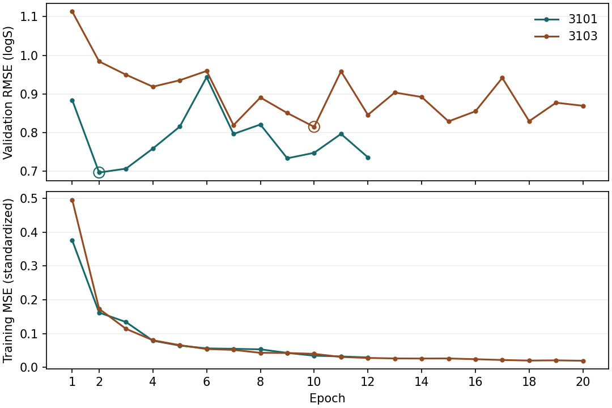

# 同一批 ESOL 分子：把轮次和划分分开看

从正式入选的 3101 第 2 轮到 3103 第 10 轮，这 21 条的平均预测变化为 -0.854 logS。固定划分比较轮次、固定轮次比较划分后，按两条比较路径取平均，划分对应的变化幅度更大。下面的比较都用同一批实测值，平均预测变化也就是平均偏差的变化。

## 四个 checkpoint 的结果

| 划分 | 轮次 | 验证 RMSE（112 条） | 21 条平均偏差 | 21 条 RMSE | 21 条 MAE | 高估条数 |
| --- | --- | --- | --- | --- | --- | --- |
| 3101 | 2 | 0.6960 | +0.895 | 0.959 | 0.895 | 21/21 |
| 3101 | 10 | 0.7471 | +0.266 | 0.434 | 0.375 | 16/21 |
| 3103 | 2 | 0.9840 | -0.252 | 0.465 | 0.422 | 3/21 |
| 3103 | 10 | 0.8144 | +0.041 | 0.334 | 0.279 | 11/21 |

平均偏差取预测减实测，正数代表高估。验证 RMSE 是整份验证集的分数，21 条巴比妥酸骨架记录都在测试集。正式成绩仍取 3101 第 2 轮和 3103 第 10 轮。

## 单独换轮次或划分

| 比较 | 平均预测变化 | 中位数 | 预测降低 / 升高 | 更接近实测的条数 |
| --- | --- | --- | --- | --- |
| 3101 内，第 10 轮减第 2 轮 | -0.629 | -0.629 | 21 / 0 | 19/21 |
| 3103 内，第 10 轮减第 2 轮 | +0.293 | +0.384 | 4 / 17 | 17/21 |
| 第 2 轮，3103 减 3101 | -1.147 | -1.267 | 21 / 0 | 18/21 |
| 第 10 轮，3103 减 3101 | -0.225 | -0.253 | 18 / 3 | 15/21 |

先固定 3101 把训练从第 2 轮延长到第 10 轮，平均预测变了 -0.629；随后固定第 10 轮换成 3103，又变了 -0.225。反过来先在第 2 轮换划分，变化是 -1.147，再在 3103 内延长训练，变化是 +0.293。两条路径的起点和终点相同。

将两条路径等权平均，轮次项为 -0.168，划分项为 -0.686 logS。两个划分的轮次变化之差为 +0.922 logS。这个拆分说明本组平均高估怎样变化。具体数值取决于这两份划分和第 2、10 轮，不能据此推断其他骨架的最佳训练轮数。划分项包括训练样本组成与训练标签标准化等一并变化的因素。

## 放回 RF 的对照里，排名还会换吗？

固定第 2 轮，3101 上 RF 的组内 RMSE 为 0.416，优于 MoLFormer 的 0.959；3103 上是 MoLFormer 的 0.465 优于 RF 的 0.577。固定第 10 轮，3101 上 RF 仍以 0.416 略优于 MoLFormer 的 0.434，3103 上仍是 MoLFormer 的 0.334 优于 RF 的 0.577。**把轮次对齐后，原来的排名翻转在两次对照中都保留了。** 这里的 RF 取各自划分正式入选的模型。

固定划分多训 8 轮，3101 的 21 个预测全部下移，19 条更接近实测；3103 的平均预测却上移，17 条更接近实测。两份划分的组内 RMSE 都下降了，但一个主要在纠正高估，另一个从平均低估向实测靠近。3101 的验证集整体 RMSE 同期从 0.6960 升到 0.7471，说明这个骨架组受益与整份验证集受益是两回事。

例如 Butabarbital（ESOL_00177）的实测 logS 为 −2.390。在 3101 上，从第 2 到第 10 轮，预测由 −1.084 降到 −1.887；在 3103 上，预测由 −2.649 升到 −2.254。两条轨迹方向相反，都更接近实测。也有例外：Metharbital（ESOL_00404）实测 −2.230，3103 第 2 轮的 −2.253 已很接近，第 10 轮反而升到 −1.636。

## 原结果复现到什么程度

| 划分 | 正式权重轮次 | 完全一致的状态张量 | 112 条验证预测最大绝对差 | 21 条测试预测最大绝对差 |
| --- | --- | --- | --- | --- |
| 3101 | 2 | 211/211 | 0 | 7.61e-07 |
| 3103 | 10 | 211/211 | 0 | 6.88e-07 |

两次各训练 10 轮，仅用各自训练和验证文件。M1 学习率 0.00003，训练种子 0，微批量 4、有效批量 8。用独立进程重载四个 checkpoint，逐一复算完整验证集，之后对 21 条按同一 ID 顺序推理。为消除测试批次的差别，四次均只对这 21 条组批；与原始测试批次的数值差见上表。

## 全部 21 条逐项对照

| ID | 名称 | 实测 | 3101 第 2 轮 | 3101 第 10 轮 | 3103 第 2 轮 | 3103 第 10 轮 | 3101 轮次差 | 3103 轮次差 |
| --- | --- | --- | --- | --- | --- | --- | --- | --- |
| ESOL_00027 | Butethal | -1.661 | -1.307 | -2.057 | -2.000 | -2.258 | -0.749 | -0.259 |
| ESOL_00147 | Amobarbital | -2.468 | -1.493 | -2.080 | -2.981 | -2.349 | -0.586 | 0.632 |
| ESOL_00177 | Butabarbital | -2.390 | -1.084 | -1.887 | -2.649 | -2.254 | -0.803 | 0.396 |
| ESOL_00231 | 5-Allyl-5-methylbarbital | -1.160 | -0.933 | -1.471 | -1.478 | -1.463 | -0.539 | 0.015 |
| ESOL_00273 | Talbutal | -2.016 | -1.257 | -1.911 | -2.485 | -2.270 | -0.655 | 0.215 |
| ESOL_00282 | 5,5-Diisopropylbarbital | -2.766 | -1.333 | -1.888 | -2.195 | -2.341 | -0.554 | -0.147 |
| ESOL_00285 | Barbital | -2.400 | -1.172 | -1.684 | -1.698 | -1.766 | -0.512 | -0.067 |
| ESOL_00404 | metharbital | -2.230 | -0.902 | -1.508 | -2.253 | -1.636 | -0.606 | 0.617 |
| ESOL_00425 | Secobarbital | -2.356 | -1.543 | -2.123 | -2.754 | -2.411 | -0.581 | 0.344 |
| ESOL_00571 | Pentobarbital | -2.390 | -1.288 | -2.046 | -2.833 | -2.447 | -0.759 | 0.386 |
| ESOL_00649 | 5-Allyl-5-isopropylbarbital | -1.708 | -1.176 | -1.805 | -2.443 | -2.059 | -0.629 | 0.384 |
| ESOL_00691 | 5-Allyl-5-ethylbarbital | -1.614 | -1.062 | -1.591 | -1.753 | -1.821 | -0.529 | -0.067 |
| ESOL_00701 | probarbital | -2.210 | -1.127 | -1.866 | -2.439 | -2.011 | -0.739 | 0.428 |
| ESOL_00772 | 5,5-Diallylbarbital | -2.077 | -0.981 | -1.637 | -2.688 | -1.861 | -0.656 | 0.827 |
| ESOL_00779 | 5-Ethyl-5-(3-methylbutyl)barbital | -2.658 | -1.493 | -2.080 | -2.981 | -2.349 | -0.586 | 0.632 |
| ESOL_00825 | 5-Ethyl-5-isopropylbarbituric acid | -2.148 | -1.127 | -1.866 | -2.439 | -2.011 | -0.739 | 0.428 |
| ESOL_00889 | 5-Methyl-5-ethylbarbituric acid | -1.228 | -0.837 | -1.535 | -1.490 | -1.446 | -0.698 | 0.044 |
| ESOL_00898 | 5-(3-Methyl-2-butenyl)-5-ethylbarbital | -2.253 | -1.602 | -1.974 | -3.069 | -2.305 | -0.372 | 0.764 |
| ESOL_00900 | butallylonal | -2.647 | -2.049 | -2.681 | -3.205 | -3.049 | -0.633 | 0.156 |
| ESOL_00971 | 5,5-Dimethylbarbituric acid | -1.742 | -0.483 | -1.284 | -1.228 | -1.220 | -0.801 | 0.008 |
| ESOL_01036 | 5-(3-Methyl-2-butenyl)-5-isoPrbarbital | -2.593 | -1.675 | -2.153 | -2.944 | -2.524 | -0.478 | 0.420 |

单位均为 logS。沿用正式实验的计分方式，重复连接结构的观测逐条保留，21 条对应 19 种非手性连接结构。[paired_21.csv](paired_21.csv) 另列每条在相同轮次下的划分差。四份权重保存在本地 3101 和 3103 子目录，[weights.csv](weights.csv) 给出文件名和校验值。

## 选轮时看到了什么

3101 在第 2 轮达到最低验证 RMSE（0.6960），又训练 10 轮仍未刷新。3103 第 7 轮已降至 0.8187，第 10 轮以 0.8144 入选。圆圈标出正式入选轮次。

[每轮记录](curves.csv) · [四格测试成绩](group_scores.csv) · [复现差值](reproduction.csv)
