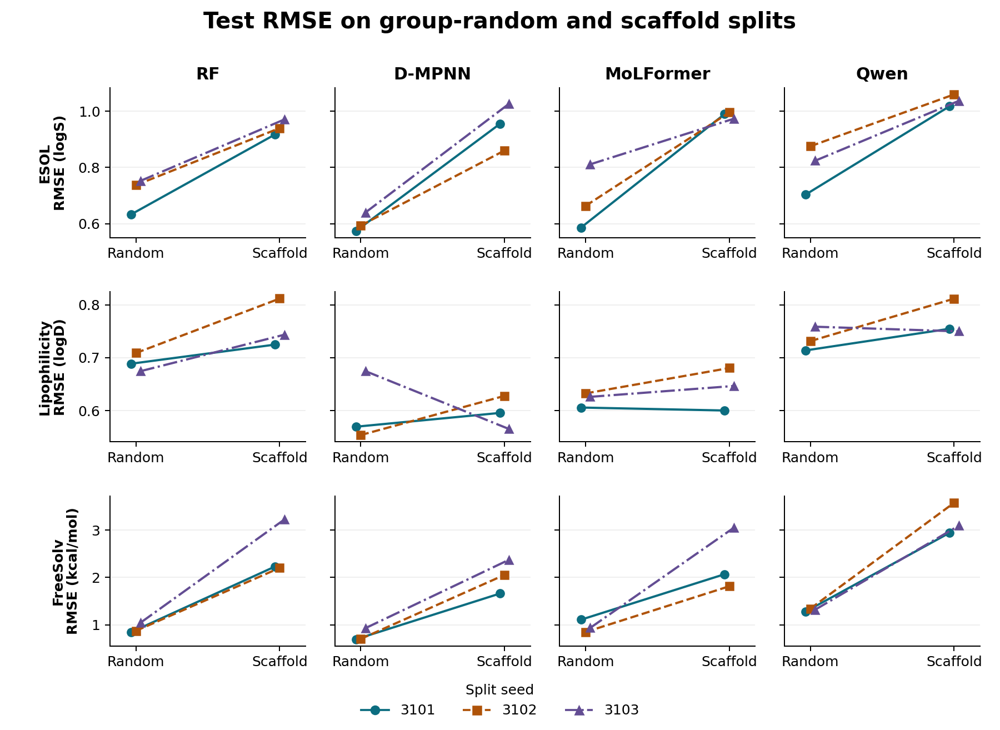
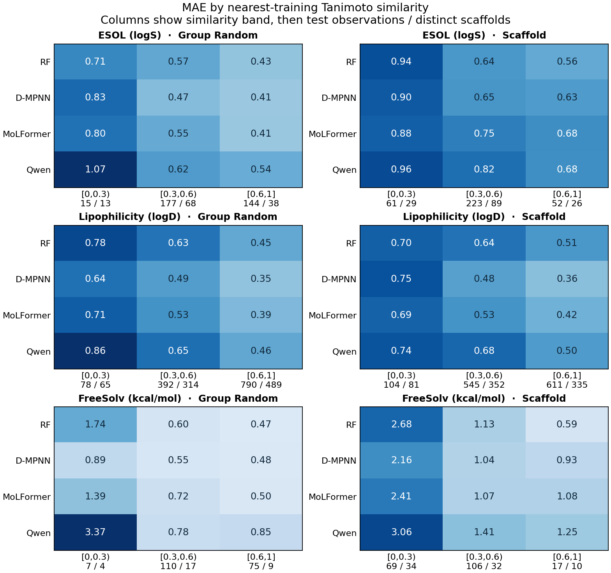

# 结构相似度与三个任务的泛化结果

**换成骨架整组留出后，ESOL 和 FreeSolv 的四个模型在三个种子上 RMSE 全部升高；Lipophilicity 的变化较小，部分种子反而下降。** 在三个任务、两种划分的每个设置中，把三个种子的记录合在一起，四模型在低相似度档的 MAE 都高于高相似度档。

## 从 Group Random 到 Scaffold



每个面板保留 3101、3102、3103 三条线。纵轴在同一性质内统一，越低越好。两端使用同一编号的划分种子，两种划分抽到的分子可以不同。跨性质比较看相对变化。下表先在每个种子上算 100 ×（Scaffold RMSE / Random RMSE − 1），再对三个百分比求平均。[各点原值、RMSE 和 MAE 变化](split_changes.csv)

| 性质 | RF | D-MPNN | MoLFormer | Qwen |
|---|---:|---:|---:|---:|
| ESOL | +33.8% | +57.3% | +46.4% | +30.5% |
| Lipophilicity | +10.0% | +0.6% | +3.3% | +5.2% |
| FreeSolv | +174.2% | +161.6% | +141.9% | +143.3% |

FreeSolv 上 D-MPNN 的平均测试 RMSE 从 0.778 升至 2.030 kcal/mol。Lipophilicity 上 D-MPNN 的变化随种子而变，三个相对变化的范围为 −16.2% 到 +13.4%；它在三个 Scaffold 测试集上仍都排第一。

## 相似度低到什么程度时误差会变大？



每个格子是该档所有测试记录的平均绝对误差。三次划分中同一 ID 再次进入测试集时按一次新的预测计入。表中另列去重 ID 数和骨架数；同一骨架可能跨档。颜色深浅仅在同一任务内比较。[逐种子分档结果](bins_by_seed.csv) · [汇总表](bins_pooled.csv)

| 性质 | 划分 | 最高 Tanimoto | 测试记录 | 去重 ID | 去重骨架 | RF | D-MPNN | MoLFormer | Qwen |
|---|---|---|---:|---:|---:|---:|---:|---:|---:|
| ESOL | Group Random | [0,0.3) | 15 | 14 | 13 | 0.713 | 0.834 | 0.803 | 1.072 |
| ESOL | Group Random | [0.3,0.6) | 177 | 160 | 68 | 0.569 | 0.466 | 0.552 | 0.624 |
| ESOL | Group Random | [0.6,1] | 144 | 135 | 38 | 0.431 | 0.408 | 0.413 | 0.541 |
| ESOL | Scaffold | [0,0.3) | 61 | 53 | 29 | 0.943 | 0.902 | 0.876 | 0.956 |
| ESOL | Scaffold | [0.3,0.6) | 223 | 187 | 89 | 0.644 | 0.646 | 0.749 | 0.816 |
| ESOL | Scaffold | [0.6,1] | 52 | 49 | 26 | 0.561 | 0.626 | 0.684 | 0.682 |
| Lipophilicity | Group Random | [0,0.3) | 78 | 70 | 65 | 0.775 | 0.644 | 0.710 | 0.858 |
| Lipophilicity | Group Random | [0.3,0.6) | 392 | 356 | 314 | 0.634 | 0.492 | 0.531 | 0.650 |
| Lipophilicity | Group Random | [0.6,1] | 790 | 709 | 489 | 0.449 | 0.347 | 0.388 | 0.455 |
| Lipophilicity | Scaffold | [0,0.3) | 104 | 96 | 81 | 0.697 | 0.748 | 0.691 | 0.740 |
| Lipophilicity | Scaffold | [0.3,0.6) | 545 | 487 | 352 | 0.637 | 0.480 | 0.527 | 0.680 |
| Lipophilicity | Scaffold | [0.6,1] | 611 | 554 | 335 | 0.515 | 0.363 | 0.416 | 0.500 |
| FreeSolv | Group Random | [0,0.3) | 7 | 7 | 4 | 1.743 | 0.885 | 1.393 | 3.370 |
| FreeSolv | Group Random | [0.3,0.6) | 110 | 104 | 17 | 0.601 | 0.546 | 0.724 | 0.780 |
| FreeSolv | Group Random | [0.6,1] | 75 | 66 | 9 | 0.468 | 0.481 | 0.505 | 0.850 |
| FreeSolv | Scaffold | [0,0.3) | 69 | 56 | 34 | 2.680 | 2.158 | 2.413 | 3.055 |
| FreeSolv | Scaffold | [0.3,0.6) | 106 | 91 | 32 | 1.130 | 1.041 | 1.072 | 1.409 |
| FreeSolv | Scaffold | [0.6,1] | 17 | 15 | 10 | 0.589 | 0.931 | 1.079 | 1.252 |

在 FreeSolv Scaffold 上，低相似度档有 69 条测试记录、34 种骨架，高相似度档只有 17 条、10 种骨架。D-MPNN 在两档的 MAE 分别为 2.158 和 0.931 kcal/mol。FreeSolv Random 的低相似度档更小，三次划分分别只有 3、3、1 条，不宜用这一档的名次判断模型优劣。

低档和高档的差距较一致，中间档并非总是落在两者之间。例如 FreeSolv Random 上 Qwen 的中、高档 MAE 是 0.780 和 0.850 kcal/mol。模型总体排名也不一定延续到每一档：Lipophilicity Scaffold 上整体领先的是 D-MPNN，但低相似度档 MoLFormer 的 MAE 为 0.691，D-MPNN 为 0.748 logD。这是按相似度分组后的观察，各档的化学组成和标签分布也会变化。

## 近邻核对与复算

每个测试分子只搜索对应划分的训练集。沿用旧分析，输入为去手性的连接结构 SMILES，计算半径 2、2048 位的 Morgan 二进制指纹，取最高 Tanimoto。有多个最高分时沿用原始训练表中先出现的记录，另存并列条数。0.3 归中档，0.6 归高档；无环分子沿用原划分的同一无环标记。

ESOL 的 672 条和 Lipophilicity 的 2,520 条测试记录全部重新搜索。最近训练 ID 与旧表逐条相同，最高相似度与旧 CSV 的最大绝对差约 1.11×10⁻¹⁶。FreeSolv 六份测试划分各 64 条，每次在该划分的 514 条训练记录中搜索，共新增 384 条。3,576 条测试记录按 ID 对齐 14,304 个正式预测，重算的 72 组 RMSE、MAE 与正式表一致（容差 10⁻¹⁰）。[逐分子最近训练邻居](nearest_test.csv) · [18 份划分核对](audit.csv)

从仓库根目录运行下面两条命令，即可用公开的[分子与正式分区清单](folds.csv.gz)、[锁定模型的测试预测](../test_predictions.csv)和[旧近邻表](../../analysis/nearest_training_similarity.csv)复算。分区清单收录三任务原训练流程使用的 ID、连接结构、骨架、原单位标签和每次分区，FreeSolv 标签取 SAMPL 的实验值 expt。

```sh
python results/structure/analyze.py
python results/structure/figures.py
```

本次环境使用 rdkit 2023.9.6、numpy 1.26.4、pandas 2.2.3、matplotlib 3.10.3。
